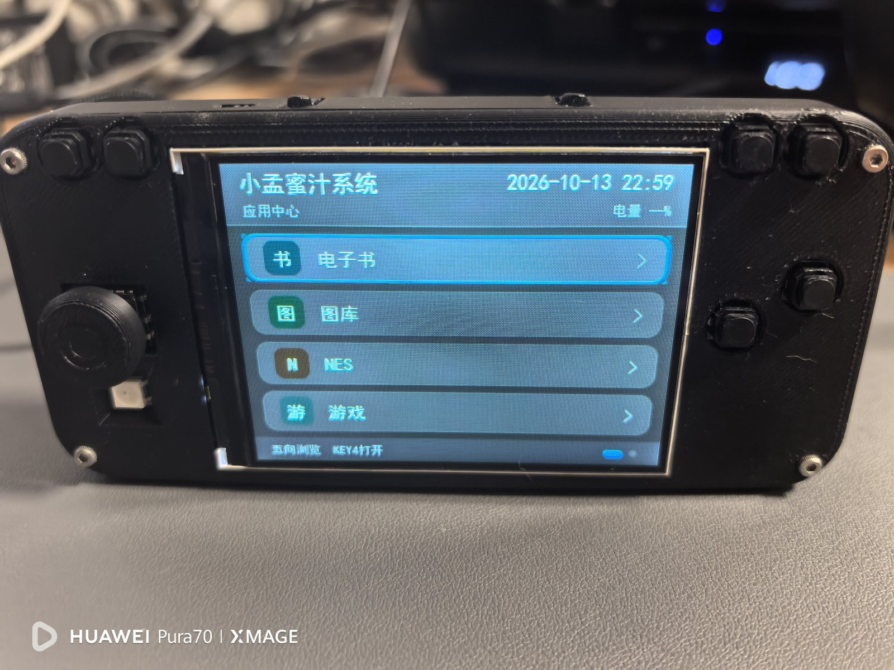
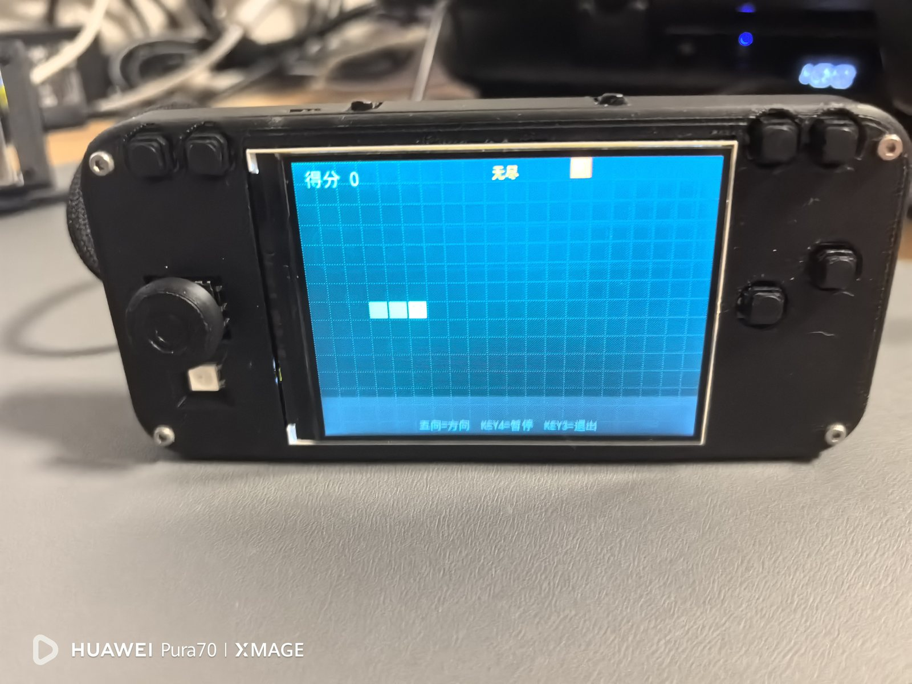
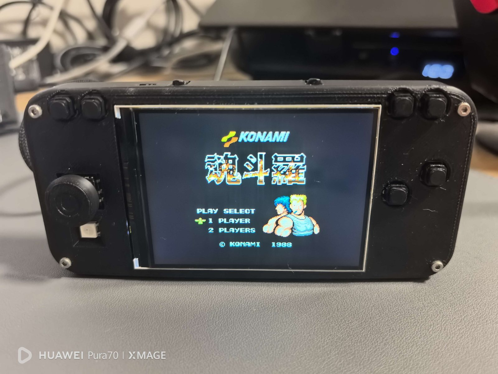

This project is a small **ESP32-S3 handheld console and multimedia device**. It combines a custom PCB, a 320×240 color display, physical controls, an SD card, audio output, wireless connectivity, and a menu-driven firmware system.

The project is useful as both a working handheld and a complete embedded-systems study. The hardware design is available as a JLCPCB project archive, while the firmware is maintained in a separate public GitHub repository.



## What the device can do

The firmware is built around ESP-IDF 5.5 and LVGL 9. From the main menu, the device provides:

- TXT ebook reading, including UTF-8, UTF-16, GBK, and GB2312 text;
- MP3 and WAV playback from the SD card;
- JPG/JPEG image browsing and wallpaper playback;
- NES game support through the nofrendo emulator core;
- Built-in Snake, Shooter, Tetris, Breakout, and Invader games;
- Wi-Fi scanning, connection management, saved passwords, and SNTP time synchronization;
- BLE advertising with a `XiaoMeng-SYS` device name and readable battery information;
- A WS2812B status light, system settings, button testing, and system information;
- Serial file transfer through the CH340 interface, so an SD card can be managed without removing it.

The software uses virtual lists for long music and ebook libraries. Large books are read in 4 KB streams with a page index instead of loading the entire file into memory. This keeps the user interface responsive and avoids treating the 8 MB PSRAM as an unlimited buffer.

## Hardware platform

The main controller is an **ESP32-S3-WROOM-1-N16R8** module with 16 MB Flash and 8 MB OPI PSRAM. The display is an ST7789 320×240 panel used in landscape orientation, with an 80 MHz SPI clock. A separate SPI bus is used for the FAT32 SD card.

| Subsystem | Part or interface | Purpose |
|---|---|---|
| MCU | ESP32-S3-WROOM-1-N16R8 | Application processor and wireless controller |
| Display | ST7789, 320×240 | Main graphical interface |
| UI | LVGL 9 | Menus, lists, settings, and applications |
| Storage | FAT32 microSD | Books, music, photos, wallpapers, and NES ROMs |
| Audio | MAX98357A over I2S | Speaker output for music and games |
| Status light | WS2812B | System and activity indication |
| Battery monitor | ADC voltage divider | Battery voltage estimation |

The firmware's board configuration is kept in [`main/board_config.h`](https://github.com/mengqy2022/ESP32-S3-XMMZ/blob/main/main/board_config.h). This file is the best reference when wiring, debugging, or adapting the board.

## Display and control signals

The ST7789 display uses SPI2. Its key signals are clock on GPIO48, MOSI on GPIO12, chip select on GPIO14, data/command on GPIO47, reset on GPIO3, and PWM backlight control on GPIO39. The display is write-only, so no MISO line is required.

The SD card uses a separate SPI3 bus: clock on GPIO13, MOSI on GPIO11, MISO on GPIO9, and card detection on GPIO10. The audio amplifier receives I2S clock, word-select, and data on GPIO41, GPIO42, and GPIO40.

The control panel has a five-way directional switch and several independent buttons. The main mappings include GPIO18 for Menu/Home, GPIO8 for Option, GPIO16 for Select/Back, GPIO17 for Start/Confirm, GPIO15 for A, GPIO5 for B, and GPIO19, GPIO6, GPIO7, and GPIO20 for Left, Right, Up, and Down. GPIO0 is used by the firmware as a normal shortcut button, although its bootloader behavior is still controlled by the ESP32-S3 ROM during reset.



## A restrained interface for a small screen

The user interface uses a dark “starry night” visual language designed for a 320×240 screen. The background is near-black, application pages are built from layered cards, and cyan-blue is reserved for focus states and important status information. Short fade transitions and compact lists keep the interface readable without putting unnecessary rendering work on the microcontroller.

The firmware also includes a screensaver. When the main screen has been idle for about 30 seconds, it can rotate wallpapers from the SD card and wake when a button is pressed.



## JLCPCB schematic and PCB project

The complete hardware design is provided as a JLCPCB project archive:

**[Download the ESP32-S3 handheld JLCPCB project](/downloads/esp32-s3-handheld-jlcpcb-project.epro)**

The archive is intended to be opened in the JLCPCB EDA environment. It contains the project metadata, schematic sheet, PCB data, symbols, footprints, and related design resources. This is the appropriate file for inspecting the circuit, checking connectivity, reviewing the board layout, or continuing hardware development.

The archive is shared as an engineering reference. Before manufacturing a modified board, check the schematic, footprints, component availability, assembly rules, and the actual revision of the physical hardware. The firmware pin definitions and the EDA project should be read together because they describe different sides of the same system: the EDA project describes the electrical design, while `board_config.h` describes how the firmware uses those connections.


## Firmware repository

The complete device software is available here:

**[ESP32-S3-XMMZ on GitHub](https://github.com/mengqy2022/ESP32-S3-XMMZ)**

The repository contains the ESP-IDF application, LVGL integration, display and audio drivers, button handling, SD-card services, Wi-Fi and BLE services, the NES core, built-in games, tools, and example storage data. It is released under the MIT License. The MP3 decoder and NES emulator include their own third-party license files, which should be preserved when redistributing the firmware.

## Building and flashing the firmware

The project targets ESP32-S3 only. A typical build environment uses ESP-IDF 5.5.x:

```bash
idf.py set-target esp32s3
idf.py reconfigure
idf.py build
```

To flash and monitor the device on Windows, replace `COM7` with the actual serial port:

```bash
idf.py -p COM7 flash monitor
```

If the build reports classic-ESP32 toolchain errors or missing ESP32-S3 GPIO definitions, clear the old target configuration and select `esp32s3` again. The repository README contains the complete recovery procedure and the dependency information required by ESP-IDF Component Manager.

## SD card layout

The firmware expects a FAT32 card with directories like these:

```text
/sdcard/
├── books/       # .txt ebooks
├── music/       # .mp3 and .wav files
├── games/       # .nes ROM files
├── gallery/     # .jpg and .jpeg images
├── Pictures/    # compatible image directory
├── DCIM/        # compatible image directory
└── wallpaper/   # screensaver images
```

Long file names and UTF-8 file names are enabled, so Chinese book and game names can be used directly on the card.


## Design notes and possible next steps

The current project already covers the complete path from electrical design to application software and a working prototype. A useful next step would be to add a short manufacturing appendix with the board dimensions, layer count, connector locations, battery specification, and a tested flashing procedure. Those details should be measured from the final board or confirmed from the EDA project before publication.

Other natural extensions include a dedicated wiring diagram, a pinout illustration for the front-panel controls, benchmark measurements for battery life and frame rate, and a release package containing a reproducible firmware binary. Keeping those items in the firmware repository would make the project easier for other builders to reproduce.

## Conclusion

This ESP32-S3 handheld is more than a game console. It is a compact example of how a custom PCB, an RTOS-based firmware stack, a graphical interface, file-based storage, audio, wireless services, and emulation can be integrated into one portable device. The public firmware and JLCPCB project make the design inspectable, reusable, and ready for further hardware and software improvements.

::github{repo="mengqy2022/ESP32-S3-XMMZ"}
