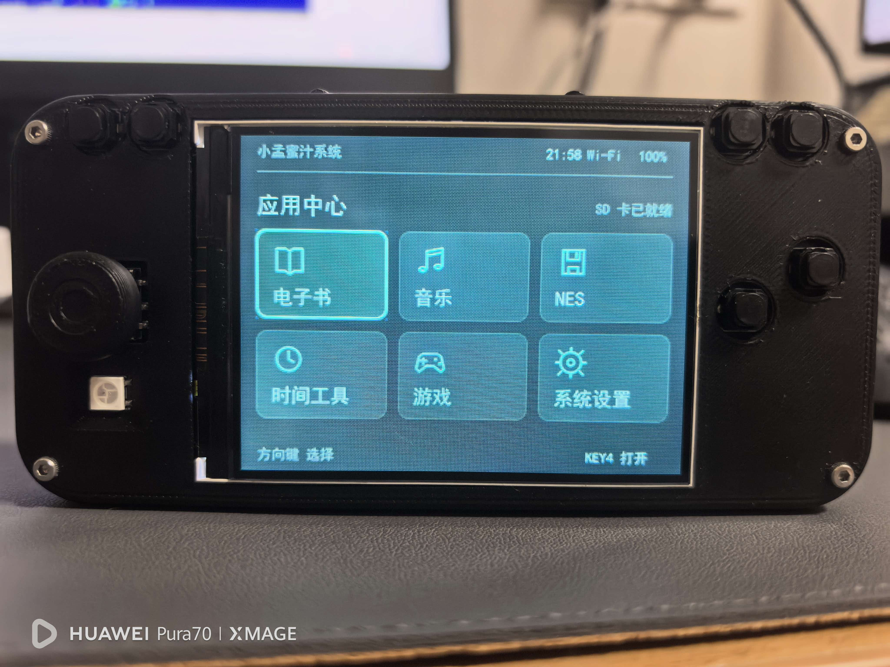
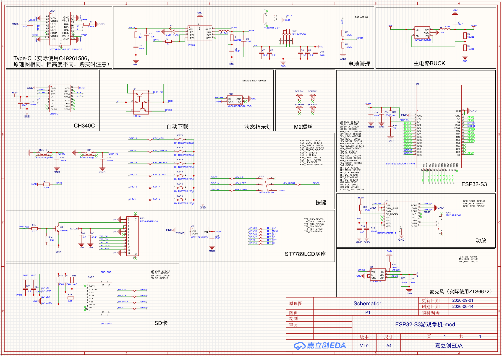
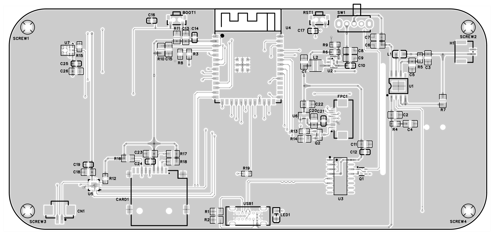
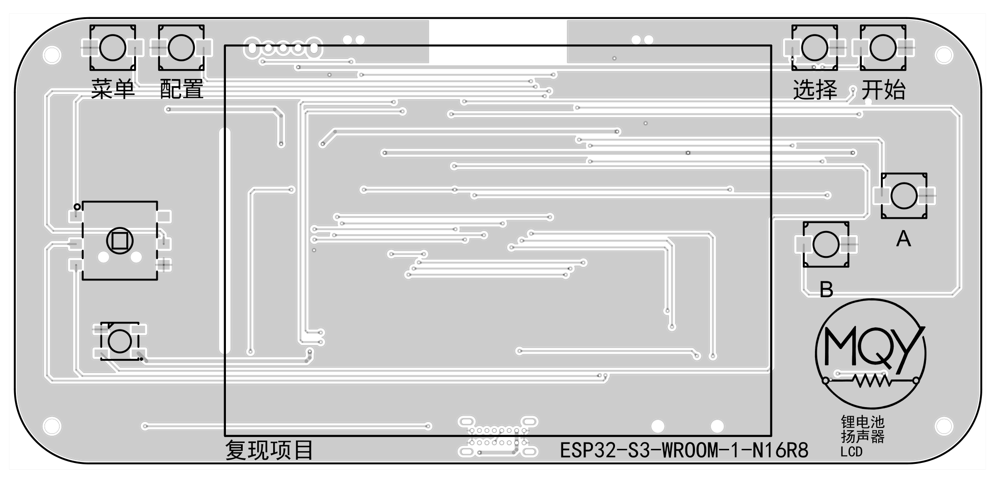
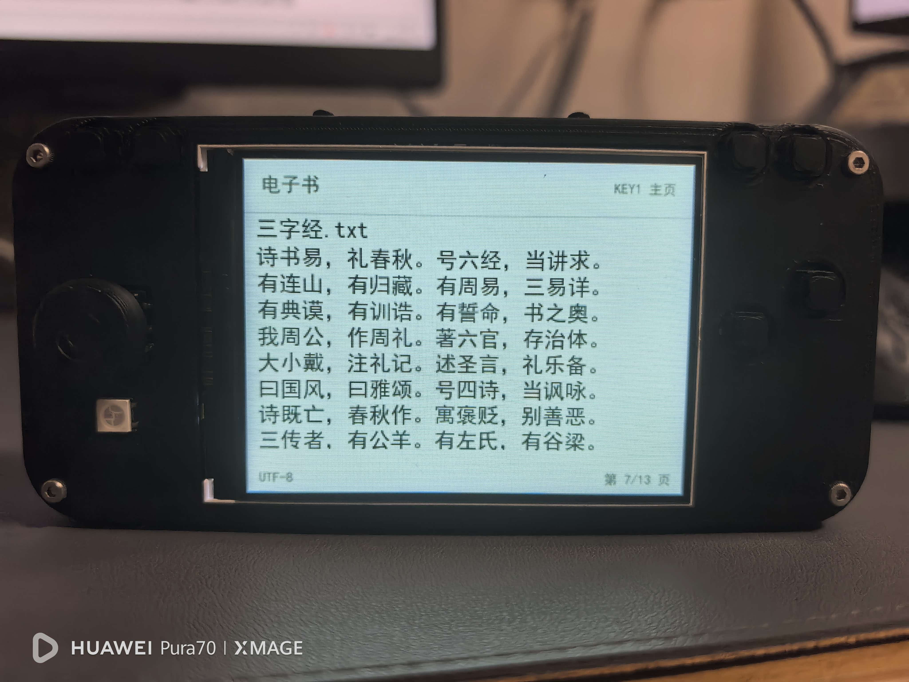
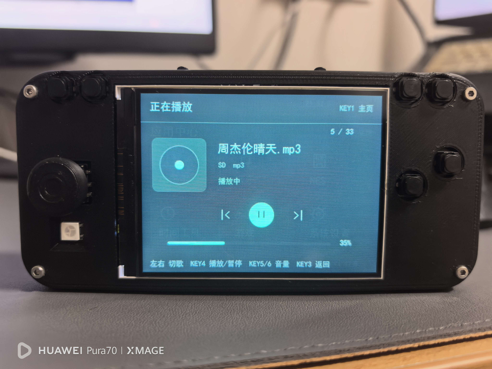
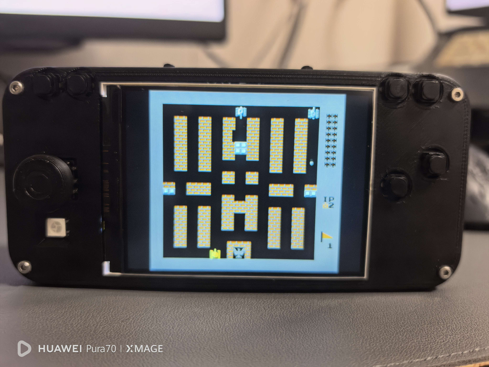
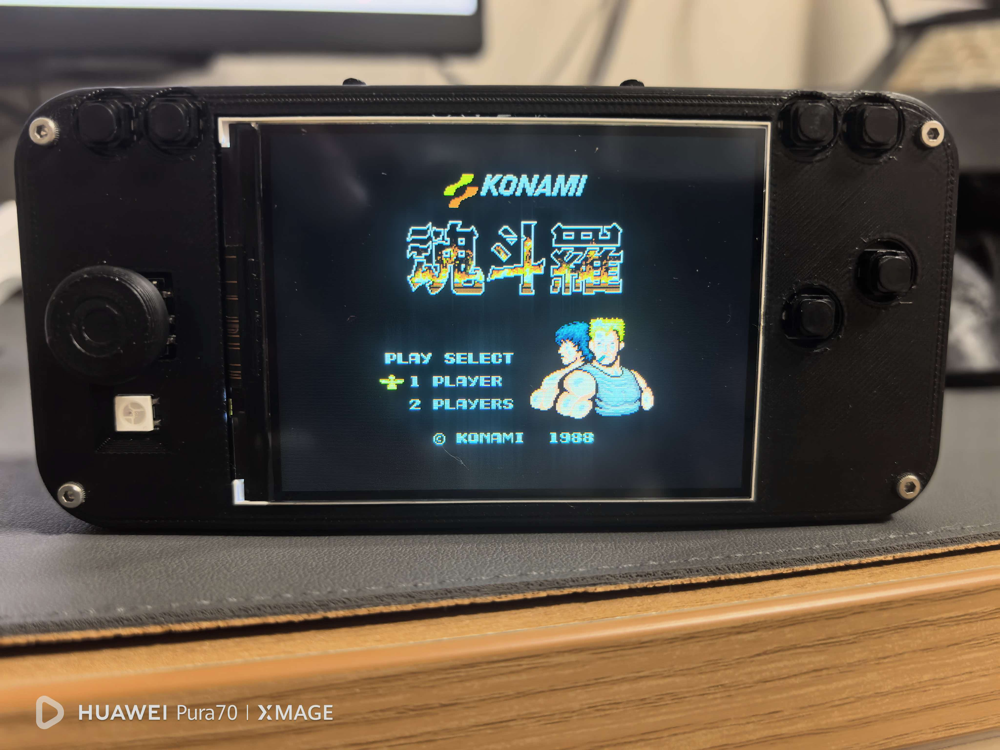
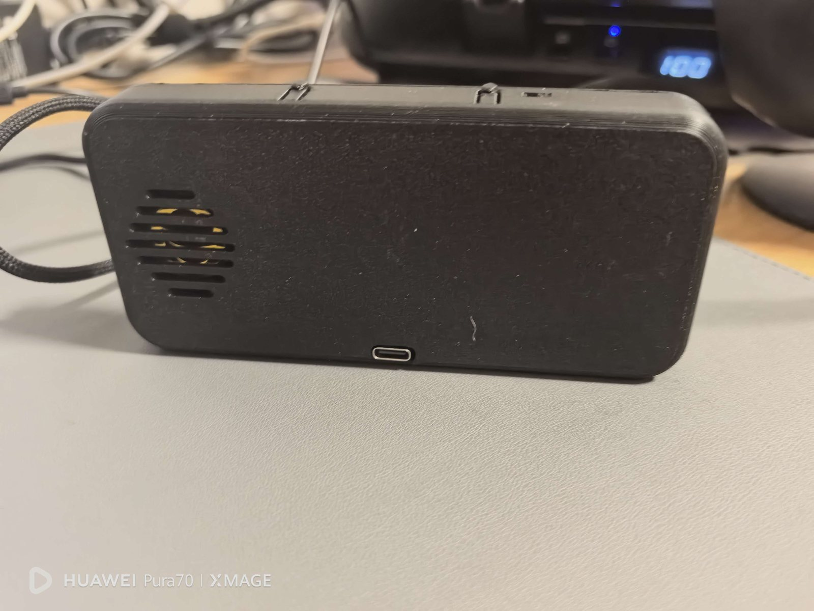
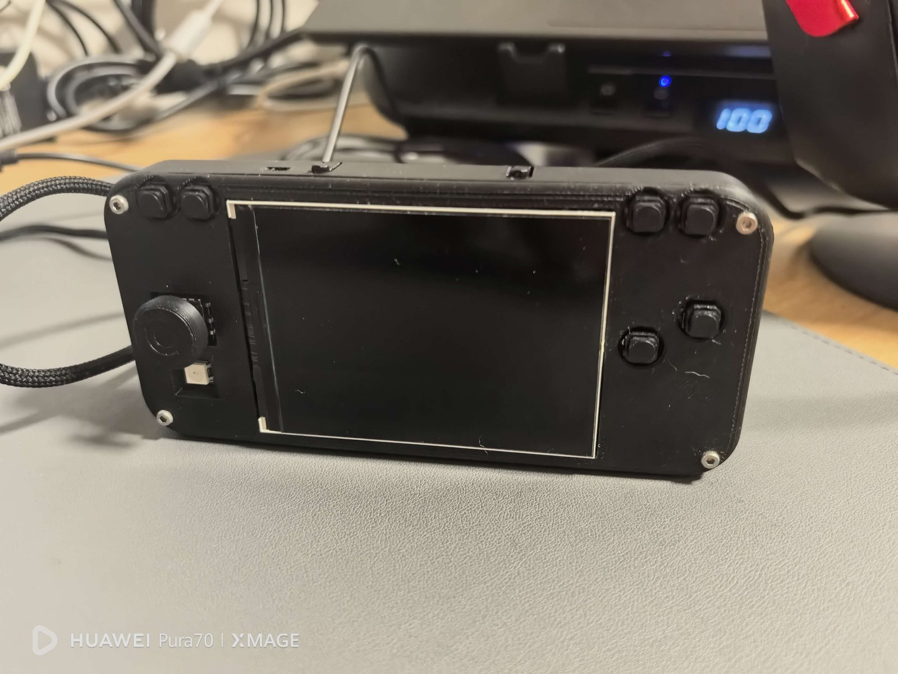

This project brings a custom circuit, a two-layer PCB, a handheld enclosure, and an ESP-IDF application together in one portable device. At its center is an **ESP32-S3-WROOM-1-N16R8**, driving a 320×240 color display, physical controls, microSD storage, speaker output, and wireless services.

The software is **小孟蜜汁系统 (Xiaomeng Mizhi System)**. Its current **v1.1-MZ** interface opens six applications from a single home screen: ebooks, music, NES, time tools, built-in games, and system settings. It can serve as a reader, a music player, a small game console, and a platform for learning how an embedded system shares limited memory and peripherals.



The new prototype photos show the six-tile launcher on the physical display, Chinese text rendering, the music playback page, and two NES titles. The black enclosure places the directional control on the left and action buttons on the right, with four menu buttons above the screen and the status LED visible below the directional control.

This article documents v1.1-moss alongside the circuit and PCB that support it. The editable hardware is available as a JLCPCB EDA project, and the firmware is maintained in the [ESP32-S3-XMMZ repository](https://github.com/mengqy2022/ESP32-S3-XMMZ).

## What the device can do

The v1.1-MZ project records **ESP-IDF 5.5.4**, **LVGL 9.5.0**, and **esp_lvgl_port 2.9.0** in its dependency lock file. Its six home-screen entries lead to the following functions:

| Application | Current behavior |
|---|---|
| Ebooks | TXT reading with UTF-8, UTF-8 BOM, UTF-16 LE/BE, and common GBK/GB2312 text; per-book reading position |
| Music | SD-card MP3 and PCM16 WAV playback; pause, track switching, volume control, and automatic next-track playback |
| NES | ROM selection from the SD card and emulation through the nofrendo core |
| Time tools | Stopwatch with lap capture and a countdown with six presets and an audible completion reminder |
| Games | Eight built-in games, with shared pause/restart controls and separate saved high scores |
| System settings | Wi-Fi, BLE, WS2812B lighting, system information, and button testing |

The firmware also provides serial file-transfer commands through the CH340 bridge, allowing a compatible PC client to read and write SD-card files without removing the card. The maintenance tool in `tools/device_check.py` can request device status, inject button actions, and capture LCD refresh data for testing.

Compared with the earlier firmware, v1.1-moss adds time tools and expands the built-in game collection from five to eight. **The gallery and wallpaper screensaver have been removed.** An idle home screen now stays visible; old image files can remain on the SD card, but the current system does not browse or rotate them.

## Hardware platform

The main controller is an **ESP32-S3-WROOM-1-N16R8** module with 16 MB Flash and 8 MB OPI PSRAM. The display is an ST7789 320×240 panel used in landscape orientation, with an 80 MHz SPI clock. A separate SPI bus is used for the FAT32 SD card.

| Subsystem | Part or interface | Purpose |
|---|---|---|
| MCU | ESP32-S3-WROOM-1-N16R8 | Application processor and wireless controller |
| Display | ST7789, 320×240 | Main graphical interface |
| UI | LVGL 9 | Menus, lists, settings, and applications |
| Storage | FAT32 microSD | Books, music, and NES ROMs |
| Audio | MAX98357A over I2S | Speaker output for music and games |
| Status light | WS2812B | System and activity indication |
| Battery monitor | ADC voltage divider | Battery voltage estimation |

The firmware's board configuration is kept in [`main/board_config.h`](https://github.com/mengqy2022/ESP32-S3-XMMZ/blob/main/main/board_config.h). Read it together with the schematic and the relevant driver when wiring, debugging, or adapting the board: the battery divider and SD labels still need particular care, as discussed below.

## Electrical architecture

The schematic is organized around a clear power and signal flow rather than one large, undifferentiated circuit.



### USB-C, charging, and power rails

The USB-C connector supplies VBUS and exposes the D+ and D- data lines. The 5.1 kΩ resistors on CC1 and CC2 identify the port as a sink. VBUS enters the IP5306 power-management section, which handles the single-cell battery path, power switching, charging status, and the VOUT rail. A dedicated slide switch controls the battery-powered system path.

Power flows from USB or the battery through the IP5306, then through the main switch to the `+5V` system bus. The TLV62568 buck converter steps this bus down to `3V3M`. The LCD has a separate supply branch through U6. A buck converter uses an inductor and switching action to reduce voltage efficiently; the LCD branch uses a linear regulator.

| Rail | Source or regulator | Main loads |
|---|---|---|
| `VBUS` | USB-C input | USB power and charging input |
| `BAT+` | Battery node from the power-management section | Battery sensing and boost input |
| `VOUT` | IP5306 output | Main switch input |
| `+5V` | Switched IP5306 output | TLV62568 input and MAX98357A supply |
| `3V3M` | U2, TLV62568 buck converter | ESP32-S3, SD card, microphone, status LED, and logic |
| `3V3LCD` | U6, ME6210A33M3G, fed from `3V3M` | LCD supply branch |

The main converter uses L2 = 2.2 µH and the R6/R9 feedback divider of 680 kΩ / 150 kΩ. With the TLV62568's nominal 0.6 V feedback reference, the intended output is approximately `0.6 × (1 + 680/150) = 3.32 V`. These resistors set the regulator output; they do not measure the battery. The IP5306 section uses L1 = 1 µH, and multiple 22 µF capacitors support the power rails.

Battery measurement uses **R3 = 100 kΩ and R8 = 100 kΩ**, connected from `BAT+` to ground with their midpoint on GPIO4. The ADC therefore sees half the battery voltage: a 4.2 V cell produces about 2.1 V at the input, before resistor tolerance and ADC calibration are considered.

There is a hardware/firmware discrepancy to resolve: the supplied firmware's `board_config.h` describes a 680 kΩ / 150 kΩ battery divider and defines `BAT_DIVIDER_RATIO` as `0.1807`. For the schematic shown here, the nominal ratio is `0.5`. The battery calculation needs to match the assembled resistor values before its voltage or percentage display can be trusted. This article documents the difference; it does not change the firmware repository.

U6 is a nominal 3.3 V linear regulator whose input is already `3V3M`. A linear regulator needs some voltage headroom, so the label `3V3LCD` alone does not establish that this node is a regulated 3.3 V under load. Its actual voltage should be checked on the assembled board. Battery capacity, charging current, and runtime also require confirmation from the battery and hardware measurements.

### ESP32-S3 and programming interface

The ESP32-S3-WROOM-1-N16R8 is the central controller. The schematic connects the CH340C USB-to-UART bridge to the serial pins and uses an automatic-download circuit built from the DTR/RTS signals and Q1. This allows the usual ESP-IDF flashing workflow without manually moving a boot jumper for every upload.

The BOOT and RESET buttons remain available for recovery. GPIO0 is also used as a front-panel control input during normal operation, so the firmware documents its dual role: it is a user button after boot, but it still has the standard ESP32-S3 ROM bootloader behavior during reset.

### Display, storage, and audio

The ST7789 interface is routed through a dedicated SPI connection. The schematic labels the display signals as `TFT_CS`, `TFT_CLK`, `TFT_MOSI`, `TFT_DC`, `TFT_RST`, and `TFT_BLK`; the firmware maps these to GPIO14, GPIO48, GPIO12, GPIO47, GPIO3, and GPIO39. Q2, an SS8050 transistor, switches the backlight current using the GPIO39 control signal, with R13 = 2.2 kΩ at its base and R14 = 10 kΩ to ground. This lets the firmware control brightness without driving the backlight current directly from a GPIO. The LCD logic supply is a separate branch; the diagram does not show firmware-controlled switching of that entire rail.

The microSD connections are used in SPI mode by the firmware rather than as a four-bit SDIO bus. `SD_CMD`, `SD_CLK`, and `SD_DATA` become MOSI on GPIO11, clock on GPIO13, and MISO on GPIO9. R16-R18 are 10 kΩ pull-ups, and R19 = 22 Ω is in series with the clock line. Series resistance can help reduce ringing on a fast clock connection.

The schematic's `SD_CD` label on GPIO10 connects to the card socket's `CD/DAT3` pin, which serves as chip select in SPI mode. Its name should not automatically be interpreted as a separate mechanical card-detect switch. Although `board_config.h` retains the historical card-detection comment, the actual `sd_card.c` driver tries **GPIO10 first, then GPIO45**, with descending clock rates of 40 MHz, 20 MHz, 5 MHz, and 400 kHz. It does not reject a card based on the GPIO10 level, and its presence function reports successful mounting. This distinction is useful when bringing up another board revision. The display and card otherwise use separate SPI2 and SPI3 buses.

The MAX98357A receives I2S data, bit clock, and word select on GPIO40, GPIO41, and GPIO42. I2S carries digital audio to the amplifier, which converts it into a speaker-driving signal. U5 is supplied from `+5V`, and CN1 connects to its `OUTP` and `OUTN` outputs. The speaker is connected between these two outputs; neither terminal is a ground connection. C18 = 10 µF and C19 = 100 nF decouple the amplifier supply.

The microphone symbol is **ICS-43434**, with word select on GPIO1, serial clock on GPIO2, and audio data on GPIO21. The drawing explicitly notes that the physical build uses **ZTS6672**. This distinction matters when selecting a replacement: the symbol, footprint, and installed part should be checked together. The public firmware documentation does not advertise a recording application, so the microphone is documented as a hardware provision rather than a demonstrated software feature.

### User controls and indicators

The six panel buttons and four directional contacts of the five-way switch connect their GPIOs to ground when pressed. These are active-low inputs: a released input needs a pull-up, while a press reads low. The schematic labels them `KEY_MENU`, `KEY_OPTION`, `KEY_SELECT`, `KEY_START`, `KEY_A`, `KEY_B`, `KEY_LEFT`, `KEY_RIGHT`, `KEY_UP`, and `KEY_DOWN`. It explicitly shows a 10 kΩ pull-up on GPIO0, and the supplied button driver enables internal GPIO pull-ups. The switch's fifth contact is not connected in the drawing. A WS2812B-compatible status LED is driven from GPIO38.

## PCB structure and placement

The PCB project is a compact handheld-shaped board with rounded corners, four mounting holes, a central ESP32-S3 module area, and connector and control positions arranged around the enclosure.



The top view places the major functional blocks so that the board can connect directly to the enclosure: the USB-C connector is at the lower edge, the SD-card and audio sections occupy the lower-left region, the main power section is on the right, and the ESP32-S3 module is near the center. The ST7789 flex connector, LCD regulator, and backlight transistor sit to the right of the module. The button footprints and mounting holes follow the handheld front-panel geometry.

| Area in the top view | References | What to look for |
|---|---|---|
| Upper center | U4 | ESP32-S3 module and antenna at the board edge |
| Upper right | U1, L1, H1, SW1 | Battery connection, power management, and main switch |
| Right of U4 | U2, L2, U6, FPC1, Q2 | Main buck converter and display support |
| Lower right of center | U3, Q1 | USB-to-UART bridge and automatic download circuit |
| Lower edge, center | USB1, R1, R2 | USB-C power/data connector and CC resistors |
| Lower left | CARD1, U5, CN1 | microSD storage, audio amplifier, and speaker connector |
| Upper left | U7 | Digital microphone and its local supply capacitors |

The module antenna sits at the upper edge, and the export shows a gap in the surrounding copper near this region. This is useful to notice when fitting the enclosure: nearby metal, a battery, or added copper can affect Wi-Fi/BLE performance. The drawing alone does not establish RF performance.



The bottom view carries long control and display routes around the large screen opening and marks the user-facing controls in the silkscreen. It also includes the project name, the ESP32-S3 module identifier, and labels for the speaker, battery, and LCD locations. These markings make the board easier to assemble and help align the PCB with the enclosure before soldering.

The EDA archive provides more detail than the grayscale PDF. The primary board is `PCB1_1`, which is the PCB linked to `Board1`; the archive also holds a second document called `PCB1_2`. These are two PCB documents, not the two sides of a board. The supplied PDF shows the two sides of `PCB1_1`.

| Property from `PCB1_1` | Design-file value |
|---|---|
| Board outline | Approximately 130 × 60 mm, with 10 mm corner radius |
| Copper stack | Top copper and bottom copper, with an FR4 core |
| Nominal stack thickness | Approximately 1.6 mm based on stored layer thicknesses |
| Copper thickness | Approximately 35 µm on each side in the stored stack |
| Placed component records | 77, including mechanical mounting items |
| Net records | 58, including generated names for local connections |
| Routed line segments | 500: 369 on top and 131 on bottom |
| Stored track widths | 0.254 mm and 0.508 mm |
| Vias | 80, with approximately 0.305 mm drill and 0.610 mm outer diameter |
| Ground pours | One `GND` pour definition on each copper side |

Dimensions and widths are converted from the archive's mil-based geometry (`1 mil = 0.0254 mm`). These values describe this saved design, rather than an inspected fabricated board or a completed DRC result. The many unused inner-layer definitions in the file are editor layer entries; the physical stack contains two copper layers.

The two copper sides let signals cross through vias while the ground pours provide return paths. The compact placement of the power devices and their inductors reduces the distance between associated components. Actual noise, heating, and voltage drop still depend on the assembled board and operating load.

The PCB export shows the routed result, while the `.epro` archive remains the authoritative editable source. For a board revision, open the archive in JLCPCB EDA and inspect the net classes, clearances, footprints, and copper pours there rather than editing the exported picture.

## Display and control signals

The ST7789 display uses SPI2. Its key signals are clock on GPIO48, MOSI on GPIO12, chip select on GPIO14, data/command on GPIO47, reset on GPIO3, and PWM backlight control on GPIO39. The display is write-only, so no MISO line is required.

The SD card uses a separate SPI3 bus: clock on GPIO13, MOSI on GPIO11, and MISO on GPIO9. GPIO10 is labeled `SD_CD` in the drawing but connects to the socket's `CD/DAT3` contact; its chip-select role is explained above. The audio amplifier receives I2S clock, word-select, and data on GPIO41, GPIO42, and GPIO40.

The control panel has a five-way directional switch and several independent buttons. The main mappings include GPIO18 for Menu/Home, GPIO8 for Option, GPIO16 for Select/Back, GPIO17 for Start/Confirm, GPIO15 for A, GPIO5 for B, and GPIO19, GPIO6, GPIO7, and GPIO20 for Left, Right, Up, and Down. GPIO0 is used by the firmware as a normal shortcut button, although its bootloader behavior is still controlled by the ESP32-S3 ROM during reset.

### Physical buttons and everyday operation

The firmware uses the panel labels KEY1–KEY6 and SW2 in its on-screen instructions. Their roles are deliberately similar across applications, while NES maps the action buttons to a console controller.

| Panel control | GPIO | Main role |
|---|---:|---|
| KEY1 | 18 | Home; hold for about one second to exit NES |
| KEY2 | 8 | System information from home; pause in built-in games; NES volume up |
| KEY3 | 16 | Back; NES SELECT |
| KEY4 | 17 | Open/confirm; start or pause where indicated; NES START |
| KEY5 / KEY6 | 15 / 5 | Volume up/down on home and music pages; NES A/B |
| SW2 | 0 | Cycle lighting modes from home; NES volume down |
| Left / Right / Up / Down | 19 / 6 / 7 / 20 | Navigate, turn pages, or control games |

SW2 retains the logical name `KEY_BOOT` in the source. It is a normal shortcut after startup, but holding GPIO0 during reset still affects ROM bootloader entry. The direction switch contributes four directional contacts; its center contact is not connected in the schematic.

## The Moss interface on a 320×240 screen

The current theme uses a deep moss background (`0x101B1C`), layered cards, warm white text, and a mint focus color (`0xC5F3D3`). Monochrome 24-pixel line icons identify the six applications. A 120 ms fade introduces pages, while a bright outline and a slightly lighter card make the selected tile visible without a large animation.

Direction keys follow the launcher's 3×2 geometry, and returning from an application preserves the selected position. The top bar shows the clock, Wi-Fi state, and estimated battery percentage; the application area also reports SD-card readiness. The clock shows an unsynchronized state until network time is available. Volume and lighting shortcuts appear briefly as small notices instead of opening another settings screen.

The photographs show the real LCD through a camera, so its apparent cyan tint and brightness are different from the theme's source color values. The battery percentage shown in the home photo is also a firmware estimate, subject to the divider calibration discussed in the power section.

### Chinese ebooks and paper-colored reading

The reader switches to a light, paper-colored page with dark text. A book title, encoding label, and page count frame the reading area. The new photo shows `三字经.txt` rendered in Chinese, with UTF-8 and page 7 of 13 visible in the footer.



TXT files are scanned from `/sdcard/books`. The reader accepts UTF-8 and UTF-16 variants as well as common GBK/GB2312 text, using the included GB2312 font rather than implying complete Unicode glyph coverage. Up, Left, or KEY5 turns back a page; Down, Right, or KEY6 advances. KEY3 returns to the book list, and KEY1 returns home. Leaving the reader saves a separate position for each book in NVS, with compatibility for the older bookmark format.

Large books use **4 KB streaming reads and a page index** rather than loading the entire text into PSRAM. This removes the old fixed 4 MB whole-book buffer limit, although initial pagination still takes time and the index itself consumes memory. The book list reuses five visible rows as the selection moves through the catalog.

### Music with an explicit playback state

The music page shows the selected filename, its source, the track's position in the library, playback state, and volume. The new photo shows an MP3 from the SD card, with track 5 of 33 selected and volume at 35%.



Left and Right change tracks, KEY4 pauses or resumes, and KEY5/KEY6 changes volume. KEY3 stops playback and returns to the list; KEY1 stops and returns home. A normal track ending advances to the next song and wraps from the final song to the first.

The supported local formats are **MP3 and PCM signed 16-bit little-endian WAV**, with mono or stereo WAV input. MP4/M4A files are not supported by this player. The bar in the photo represents volume; the current page does not present an estimated playback-progress bar. Its labels update when playback state or volume changes, avoiding needless periodic redraws.

### Time tools

Time tools provide an offline stopwatch with lap capture and a countdown with **10-second, 1-minute, 5-minute, 10-minute, 25-minute, and 45-minute** presets. Left/Right switches modes, KEY4 starts or pauses, and KEY5 resets. KEY6 records a lap while the stopwatch runs; when the countdown is paused, Up/Down or KEY6 selects a preset.

At completion, the countdown displays a message and requests a three-note sound three times, roughly one second apart. Any button stops the remaining reminders and also performs its normal action. Sound follows system volume and mute settings. **Switching mode or leaving time tools pauses the timer**; it does not keep counting in the background while another application runs. State is retained within the current boot session.

### Eight built-in games

The built-in game hall is separate from NES and needs no external ROM for these eight games:

| Game | Gameplay and current additions |
|---|---|
| Snake | Classic, wraparound, and fast modes; buffered turns that reject a direct reversal |
| Tetris | Seven-bag piece selection, next-piece preview, landing guide, and hard drop |
| Breakout | Three stages, three lives, and paddle-angle rebounds |
| Shooter | Hold-to-fire controls, three lives, and increasing difficulty |
| Space Invaders | Successive waves, enemy shots, and hit feedback |
| 2048 | Directional tile merging, with invalid moves leaving the board unchanged |
| Pong | A computer opponent and a first-to-seven match |
| Obstacle Runner | Buffered jumps, variable jump height, and increasing difficulty |

KEY2 or KEY4 pauses and resumes a built-in game. After a game ends, KEY4 restarts, KEY3 returns to the game hall, and KEY1 returns home. Each game's high score is stored independently in NVS and written when a new record is reached. The shared runtime advances game logic in fixed 33 ms steps; that timing is a logic interval, not a measured display frame rate.

### NES on the physical prototype

The NES application reads `.nes` files from `/sdcard/games` and uses the nofrendo emulator core. The new photographs show a tank game in progress and the title screen of *Contra*, connecting the software feature list to the assembled device.





The emulator renders a native **256×240** image centered on the 320×240 display, leaving side margins instead of stretching every frame. Direction keys act as the D-pad, KEY5/KEY6 as A/B, and KEY3/KEY4 as SELECT/START. Hold KEY1 for about one second to exit; KEY2 and SW2 adjust volume during emulation.

The source currently limits the ROM browser to 24 entries and the loaded ROM size to 2 MB. Compatibility depends on the ROM and mapper, so the photographs demonstrate those examples rather than universal NES support. The application stops Wi-Fi before emulation to free internal memory, and its controller path samples GPIO directly to reduce dependence on the menu input task.

### Wireless services and system settings

Wi-Fi supports 2.4 GHz scanning, connection management, and saved credentials. A successful connection can synchronize the clock using SNTP with UTC+8 local time. BLE supports advertising and scanning, using the `XiaoMeng-SYS` name and GATT device information and battery data. The BLE battery value shares the same calibration limitations as the home-screen estimate.

Settings also expose WS2812B lighting modes, color and brightness, system and memory information, SD-card re-detection, and a button test page. Together these tools make it easier to check the assembled hardware without changing applications or reconnecting a debugger.

## JLCPCB schematic and PCB project

The complete hardware design is provided as a JLCPCB project archive:

**[Download the ESP32-S3 handheld JLCPCB project](/downloads/esp32-s3-handheld-jlcpcb-project.epro)**

The figures above were rendered from the supplied schematic and PCB PDF exports. Click the schematic or either PCB image to inspect it with the site's image viewer. English explanations accompany the original drawings, whose source labels remain unchanged.

The archive is intended to be opened in the JLCPCB EDA environment. It contains the project metadata, schematic sheet, PCB data, symbols, footprints, and related design resources. This is the appropriate file for inspecting the circuit, checking connectivity, reviewing the board layout, or continuing hardware development.

The archive is shared as an engineering reference. Before manufacturing a modified board, check the schematic, footprints, component availability, assembly rules, and the actual revision of the physical hardware. The firmware pin definitions and the EDA project should be read together because they describe different sides of the same system: the EDA project describes the electrical design, while `board_config.h` describes how the firmware uses those connections.



## Firmware repository

The complete device software is available here:

**[ESP32-S3-XMMZ on GitHub](https://github.com/mengqy2022/ESP32-S3-XMMZ)**

The repository contains the ESP-IDF application, LVGL integration, display and audio drivers, button handling, SD-card services, Wi-Fi and BLE services, the NES core, eight built-in games, the time tool, maintenance scripts, and example storage data. It is released under the MIT License. The Helix MP3 decoder and NES emulator include their own third-party license files, which should be preserved when redistributing the firmware.

## Firmware architecture and memory budget

Startup proceeds from NVS initialization to hardware self-test, LVGL setup, wireless services, and the home menu. Display, buttons, LED, battery sampling, audio, and SD storage each have a driver; application pages use shared UI helpers and services rather than configuring these peripherals themselves.

| Source area | Responsibility |
|---|---|
| `main/app_main.c` | Startup, hardware initialization, and creation of the UI task |
| `main/board_config.h` | Target protection, pin assignments, and board constants |
| `main/apps/` | Launcher, ebooks, music, NES browser, time tools, settings, and shared UI |
| `main/apps/games/` | Eight games, shared runtime, and 2048 rules |
| `main/drivers/` | ST7789, buttons, SD card, I2S audio, battery ADC, and status LED |
| `main/services/` | Music decoding, Wi-Fi, BLE, lighting state, and serial maintenance |
| `main/nes/` | Emulator integration and nofrendo core |
| `tools/` | Font/asset generation, repository checks, and device maintenance |

The 8 MB PSRAM helps with books, catalogs, and emulation, but some work still requires internal SRAM. The implementation makes that distinction explicit:

- **One LVGL execution path:** regular application pages run serially in a UI task with a 20 KB internal stack. The port's default rendering task is removed so two threads do not drive LVGL at once. During NES, the normal UI thread waits while a dedicated video worker handles presentation.
- **A small DMA-capable display buffer:** RGB565 drawing uses a single one-eighth-screen buffer, about 19.2 KB, in internal DMA memory. In this SPI configuration, keeping the buffer there avoids a temporary internal copy allocation on each flush.
- **Reuse and release:** the book and music lists reuse five visible rows, the game hall uses four, and transitions delete the previous LVGL screen tree. Music catalog data and large decoder/emulator stacks prefer PSRAM where supported.
- **Incremental work:** books stream through a 4 KB buffer with a page index; the home clock label changes only when the displayed minute changes; playback labels change with player state. These choices limit object counts and unnecessary redraws.

This architecture is documented in [`docs/DESIGN.md`](https://github.com/mengqy2022/ESP32-S3-XMMZ/blob/main/docs/DESIGN.md) and the current implementation in [`main/lvgl_port.c`](https://github.com/mengqy2022/ESP32-S3-XMMZ/blob/main/main/lvgl_port.c). Its value is in how it allocates scarce internal memory; it is not a substitute for measuring frame rate on the assembled device.

## Building and flashing the firmware

The project targets ESP32-S3 only. The supplied dependency lock records ESP-IDF 5.5.4, LVGL 9.5.0, and esp_lvgl_port 2.9.0. After installing ESP-IDF and opening its development environment, obtain the source:

```bash
git clone https://github.com/mengqy2022/ESP32-S3-XMMZ.git
cd ESP32-S3-XMMZ
```

Then configure and build:

```bash
idf.py set-target esp32s3
idf.py reconfigure
idf.py build
```

To flash and monitor the device on Windows, replace `COM7` with the actual serial port:

```bash
idf.py -p COM7 flash monitor
```

If the build reports classic-ESP32 toolchain errors or missing ESP32-S3 GPIO definitions, clear the old target configuration and select `esp32s3` again. The repository README contains the complete recovery procedure and the dependency information required by ESP-IDF Component Manager.

Component Manager restores managed dependencies from `main/idf_component.yml` and `dependencies.lock`. Generated font and icon C files are already included, so an ordinary build does not require regenerating those assets. The supplied source archive contains no prebuilt firmware binary; building produces the files used for flashing.

## SD card layout

The three content directories used by the current applications are:

```text
/sdcard/
├── books/       # .txt ebooks
├── music/       # .mp3 and .wav files
└── games/       # .nes ROM files
```

`/sdcard` is the firmware's mount point; on the card itself, place `books`, `music`, and `games` at the root. Use a FAT32 card. Long file names and UTF-8 file names are enabled, so Chinese book and game names can be used directly. JPG files from older versions can remain on the card, but there is no gallery or wallpaper application in v1.1-moss.



## Validation recorded with v1.1-moss

The supplied [`Moss release notes`](https://github.com/mengqy2022/ESP32-S3-XMMZ/blob/main/docs/MOSS_RELEASE.md) record build and device checks for this version. They report two rounds of entering, operating, pausing, and leaving all eight built-in games; SD ebook reading; MP3 playback with repeated track changes; Wi-Fi scan-page re-entry; stopwatch and countdown checks; repeated time-tool transitions; two NES launches and long-press exits; and a 45-second idle check that kept the home screen visible. The notes also record a 2048 rules test, including 40,000 randomized moves checking sum conservation.

Those are project validation records, while the five new photographs directly show the launcher, reader, music page, and two NES screens. They do not establish measured battery runtime, display frame rate, speaker loudness, or long-term wireless stability. The release notes describe earlier JPEG-stack and coexistence-related failures, the removal of image paths, stack adjustments, and a change to hardware Wi-Fi/BLE arbitration with modem sleep disabled. The resulting networking power use and long-term concurrent behavior still need observation.

## Design notes and possible next steps

The project now documents the circuit, two-layer PCB, connector placement, v1.1-moss firmware, and physical prototype together. The next practical checks are to reconcile the battery-divider constant with the assembled resistor values, verify the LCD rail under load, confirm the SD chip-select mapping, and record the installed battery specification. The schematic also notes that USB1 uses LCSC part C49261586 and that connector height matters when choosing a replacement.

Further development could add a front-panel pinout illustration, measured battery-life and frame-rate results, and a versioned release package with a reproducible firmware binary. Keeping those records alongside the source would make it easier to relate a photo, a PCB revision, and an exact firmware build. The [user guide](https://github.com/mengqy2022/ESP32-S3-XMMZ/blob/main/docs/USER_GUIDE.md) and [Moss release notes](https://github.com/mengqy2022/ESP32-S3-XMMZ/blob/main/docs/MOSS_RELEASE.md) provide more detailed operation and validation information.

## Conclusion

This ESP32-S3 handheld is more than a game console. Its current Moss system combines a six-app LVGL interface, Chinese ebook rendering, local audio, NES emulation, eight small games, time tools, wireless setup, and hardware diagnostics on a custom portable board. The public firmware, JLCPCB project, and new real-device photos make the design inspectable while leaving clear next steps for battery calibration, enclosure refinement, and longer-term performance measurements.

::github{repo="mengqy2022/ESP32-S3-XMMZ"}
