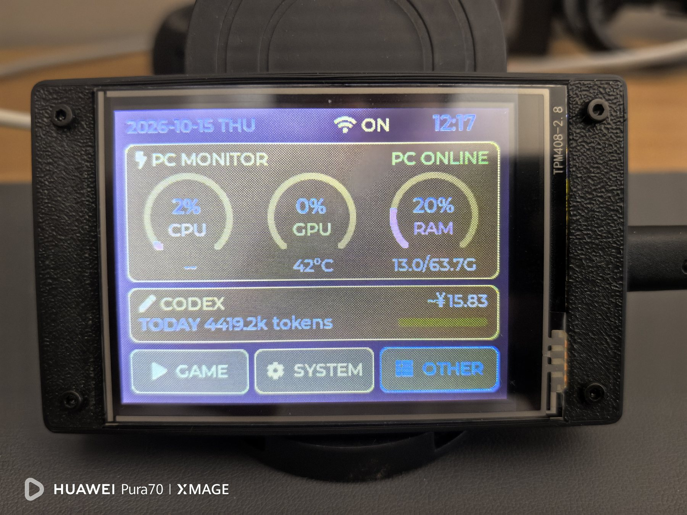
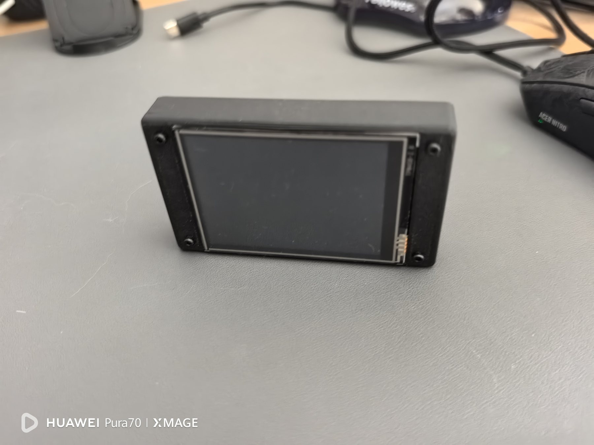
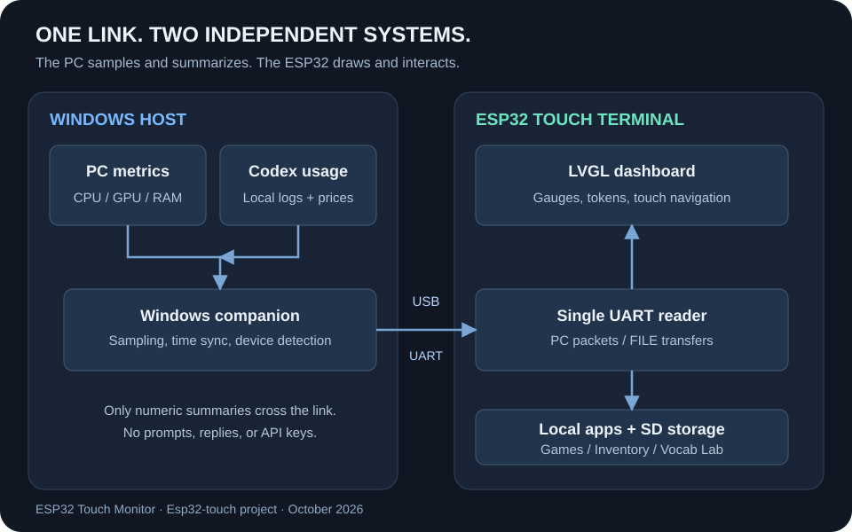

Some information belongs in a desktop window. Other information is useful when it stays in view. This project takes the second approach: a small ESP32 touch terminal continuously shows the computer's CPU, GPU, memory, temperatures, and local Codex usage for the current day.

It is not a remote desktop that mirrors the computer screen. The PC samples and summarizes numeric data; the device draws its own interface, handles touch input, and runs local tools. Even when the Windows monitor is paused, the games, Wi-Fi page, SD-card tools, and vocabulary lab remain available on the device.



## The finished device

The prototype is a landscape 320×240 LCD mounted in a black enclosure. The home screen compresses the important information into a few readable cards: the top bar shows the date, weekday, Wi-Fi state, and clock; three circular gauges show CPU, GPU, and RAM; the CODEX card shows today's tokens, an optional personal goal, and an estimated CNY cost; the bottom row opens GAME, SYSTEM, and OTHER.

The screen has two independent data paths. PC telemetry is sampled about once per second and becomes offline after five seconds without a new `STAT` packet. Codex usage is recomputed about every five seconds and becomes `NO DATA` after 90 seconds without a packet or when the host date does not match the device date. “Online” is therefore a time-limited state, rather than a permanent result from the last successful connection.



## A small system, rather than a screenshot

The project has three layers: the firmware on the device, a Windows companion program, and local data sources on the computer.



`pc_monitor_host.py` reads the metrics that Windows can provide and sends `PC:STAT`, `PC:TIME`, `PC:TZOFF`, and `PC:NAME` through the CH340 serial bridge. `codex_usage.py` scans the local Codex logs and sends the daily token count, personal goal, date, and estimated cost. On the device, `file_xfer.c` is the only UART reader; it dispatches each line to the monitor or file-transfer service according to its prefix.

That boundary is deliberate. The device receives no prompts, replies, account identifiers, or API keys, and it does not query a cloud billing service. It receives summarized values from the host and renders them locally, so a disconnected serial link does not leave the screen frozen on a captured desktop image.

## Hardware platform: the repository name is not the chip target

The repository keeps the name `Esp32-s3-touch`, but the current physical validation uses an **ESP32-D0WD-V3** and the firmware target is the classic `esp32`, not `esp32s3`. The build uses ESP-IDF 5.5.4 and LVGL 8.4. This alignment between the actual chip, target, and display driver matters when reproducing the project.

| Subsystem | Part or interface | Purpose |
| --- | --- | --- |
| Controller | ESP32-D0WD-V3 | FreeRTOS, LVGL, and local applications |
| Display | ILI9341, 320×240, landscape | Dashboard and application rendering |
| Touch | XPT2046 resistive touch controller | Touch input and three-point affine calibration |
| Storage | SPI microSD | Inventory, BOM, vocabulary, and study progress |
| USB | CH340 USB-UART bridge | Flashing, telemetry, and file transfer |
| Indicator | Common-anode RGB LED | Startup, scan, and error states |

The display has its own SPI bus, the touch controller uses software SPI, and the SD card uses another SPI bus. The main pin assignments are below; `main/board_pins.h` remains the authoritative reference when changing the board.

| Function | GPIO |
| --- | --- |
| LCD SPI: SCK / MOSI / MISO / CS / DC / BL | 14 / 13 / 12 / 15 / 2 / 21 |
| XPT2046: SCK / MOSI / MISO / CS / IRQ | 25 / 32 / 39 / 33 / 36 |
| microSD: SCK / MISO / MOSI / CS | 18 / 19 / 23 / 5 |
| RGB LED: R / G / B | 17 / 22 / 16 |

The LCD runs in landscape RGB565 mode. LVGL renders into DMA-capable internal buffers, and the ILI9341 driver sends larger SPI transactions instead of splitting every small widget into many transfers.

## Touch calibration: turning ADC readings into reliable taps

XPT2046 reports raw ADC coordinates, not screen pixels. On first boot, or after calibration data is cleared, the device displays three crosshairs, collects three raw coordinate pairs, and solves an affine transform from touch space to screen space. The result is stored in NVS and loaded on later boots.

The SYSTEM menu provides `CALIBRATE`, and holding the BOOT button for about two seconds starts the same process. During calibration the LVGL task is suspended so the bare-metal LCD driver owns the SPI bus; LVGL resumes after the result is saved. This keeps calibration and screen refresh from competing for the same bus.

## The home screen: important information at a glance

The home page is a continuously updating dashboard rather than a scrolling list:

- The top bar shows the device date, weekday, Wi-Fi state, and clock. Time can arrive over USB, while Wi-Fi SNTP remains available.
- CPU, GPU, and RAM use circular gauges. Temperatures and used/total memory sit below the gauges. If the host cannot provide a sensor, the display shows `--` instead of pretending the value is zero.
- The CODEX card shows today's input plus output tokens. A configured goal is a personal reference and does not represent an official plan quota.
- Costs appear as an estimate such as `~¥12.34`. If a model price or required token breakdown is missing, the display stays at `~¥--` while the token count remains available.

The three bottom categories keep the 240-pixel-high home page from becoming a crowded menu. The current home page stays visible while idle, so the monitor remains in view during normal desktop use.

## Three categories for daily use

### GAME: useful even without the PC

GAME contains SUDOKU, 2048, and FLAPPY. These run entirely on the device and do not require the PC, Wi-Fi, or SD card. They use the same touch event and back-navigation model as the rest of the firmware.

### SYSTEM: maintenance as an interface

SYSTEM provides SD CHECK, SYSTEM INFO, WIFI, CALIBRATE, and PC DETAILS.

- **SD CHECK** shows mount state, capacity, and scan results, with manual and AUTO scanning.
- **SYSTEM INFO** exposes chip, memory, uptime, and network details for diagnosis.
- **WIFI** scans access points, accepts a password, connects or disconnects, and stores credentials in NVS.
- **CALIBRATE** asks for confirmation before changing the touch transform.
- **PC DETAILS** gives a larger clock and a more complete view of CPU/GPU/RAM, temperatures, time source, and host state.

SD scanning runs in its own FreeRTOS task. The RGB LED is blue while scanning, green on success, and red on failure; the UI task remains responsive instead of blocking while a directory is inspected.

### OTHER: local data and learning tools

OTHER contains INVENTORY and VOCAB LAB. Inventory data lives on the SD card in UTF-8 `PRODUCT_NO,MODEL,QTY` records. The device can filter, increment, decrement, and delete entries; the companion serial tools can upload supported BOM or purchasing CSV files.

VOCAB LAB is an offline-first vocabulary workspace with book browsing, study cards, spaced review, touch dictation, and daily plans. Books are read as streams with an index instead of loading an entire file into RAM. Handwriting is processed as lightweight local strokes and is not uploaded to a cloud OCR service.

## One serial link with clear service boundaries

The device and Windows program use an ASCII line protocol at 115200 baud. The main telemetry packets are:

```text
PC:STAT|cpu|gpu|cpu_C|gpu_C|mem|used_MB|total_MB
PC:CODEX|today_tokens|daily_goal|YYYYMMDD|estimated_CNY_fen
PC:TIME|unix_seconds
PC:TZOFF|minutes
PC:NAME|hostname
```

`PC:STAT` and `PC:CODEX` have independent validity windows: a fresh Codex packet does not make an expired CPU sample online again. Older hosts can omit the extended memory fields or the cost field and remain compatible.

The same UART also carries `FILE:LIST`, `FILE:PUT`, `FILE:GET`, and `FILE:DEL`. The shared reader processes every complete line in a read chunk and retains a partial line across reads. A file upload waits for `FILE:READY` before sending its exact binary length. This prevents later `CODEX` or `PING` packets from being lost during a burst.

Only one program should own the serial port at a time. Pause the Windows monitor before flashing, opening a serial console, or using an inventory tool, then resume it when the operation is complete.

## Codex cost is an explainable estimate

Codex usage comes from the local session logs and is grouped by the computer's local calendar date. The reader parses model and usage fields and keeps incremental offsets to avoid counting the same snapshot twice. It does not transmit prompt text, response text, credentials, or API keys to the device.

The amount uses the locally configured `codex_prices.json`: normal input, cached input, cache writes, and output are priced separately and then converted to CNY. The user owns the rates and exchange rate; the program does not connect to an official billing endpoint and does not claim to show plan balance. If the model is unknown, the breakdown is incomplete, or the price file is invalid, the amount remains unavailable instead of presenting a misleading partial total.

## Windows companion: connect when the device appears

The project includes `ESP32TouchDashboard.exe`. On first run it installs under `%LOCALAPPDATA%/ESP32TouchDashboard`, creates a Start Menu entry, and registers per-user startup. With no device attached, the background process waits without opening a nonexistent port. When the CH340 device appears, it identifies the port and starts sending telemetry.

The control window can enable or disable startup, pause or resume monitoring, open the price configuration, and view rotating logs. Pausing releases the serial port and the paused state survives the next login. If several identical USB-UART devices are connected, VID/PID alone cannot prove which one is the target, so the agent waits for a resolvable candidate instead of choosing randomly.

Host sensors depend on Windows and its drivers. The current implementation mainly uses NVIDIA NVML for GPU data, and CPU temperature can be unavailable when the computer has no usable WMI provider. Those are sensor limits, not display failures.

## Firmware decisions that keep the device responsive

`app_main()` initializes NVS, LCD, touch, and SD before starting Wi-Fi and LVGL. The SD card is mounted early, before Wi-Fi and the UI reserve more internal heap, and touch calibration is completed before the LVGL task begins. PC monitoring, file transfer, Wi-Fi observation, and the BOOT long-press task start afterward.

LVGL objects are accessed only from the LVGL task; other tasks post UI commands through a queue. Slow filesystem and network operations stay outside the drawing loop. The PC monitor updates a protected state snapshot, and the UI reads that snapshot rather than changing widgets from the UART task.

These choices prioritize sustained use on a small screen: stale data is explicit, missing values remain honest, long operations do not block touch input, and the serial port has one well-defined reader.

## Build and reproduce

The firmware uses ESP-IDF 5.5.4 with the `esp32` target:

```powershell
idf.py set-target esp32
idf.py build
idf.py -p COM5 flash
```

`COM5` is only an example. The Windows companion can be used as the repository's EXE, or built in a Python 3.11 x64 environment:

```powershell
powershell -NoProfile -ExecutionPolicy Bypass -File .\build_exe.ps1
```

The engineering repository contains the complete [Chinese README](https://github.com/mengqy2022/Esp32-s3-touch/blob/main/README_CN.md), [hardware notes](https://github.com/mengqy2022/Esp32-s3-touch/blob/main/docs/HARDWARE.md), [architecture notes](https://github.com/mengqy2022/Esp32-s3-touch/blob/main/docs/ARCHITECTURE.md), and [validation record](https://github.com/mengqy2022/Esp32-s3-touch/blob/main/docs/VALIDATION.md).

## Validation and limits

The engineering record covers firmware build and flashing, the home-page data path, Codex counting boundaries, multi-line UART reception, Windows packaging and installation, startup registration, and pause/resume behavior. Full reboot, hot-plug, multiple identical devices, sleep/wake, and 24-hour stability tests remain later acceptance work; CPU temperature is already unavailable on some hosts.

This makes the device useful today while leaving its limits visible. The project covers a complete path from hardware interfaces, touch calibration, LVGL screens, and FreeRTOS tasks to Windows collection and a serial protocol, without presenting unmeasured laboratory results as product specifications.

## Closing thoughts

The valuable part of this project is not simply lighting a small screen. It is the clean division between the computer, the embedded device, and local data: the computer samples, the serial link transports, and the ESP32 renders and interacts. Games, inventory, and vocabulary tools give the device a life of its own when the computer is away.

The result is a tool screen that can stay on the desk without interrupting the main workflow. A glance tells you whether the PC is online, whether resources are under pressure, how far today's Codex usage has progressed, and which local tool to open next.

::github{repo="mengqy2022/Esp32-touch"}
