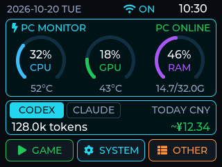
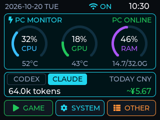
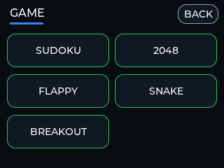
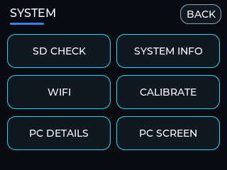
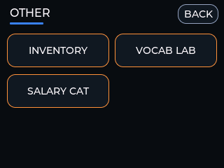
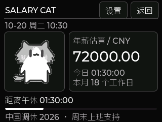
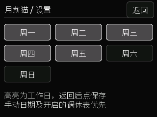
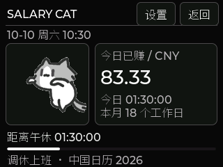

Some information belongs in a desktop window. Other information is useful when it stays in view. This project takes the second approach: a small ESP32 touch terminal continuously shows the computer's CPU, GPU, memory, temperatures, and local Codex or Claude Code usage for the current day.

The home dashboard is drawn on the device from compact data packets. A separate PC SCREEN page can stream one selected Windows application and send touch input back. Alongside these connected features, the ESP32 runs its own games, inventory, vocabulary workspace, and now **Salary Cat**: a local earnings dashboard that turns a work schedule into a daily progress display, accompanied by an animated cat.

This log follows the **October 20, 2026 source update**. It adds illustrated screen guides and Salary Cat while retaining the existing PC monitor and window-sharing system. The published EXE and firmware downloads are still the October 18 release and **do not include Salary Cat**; the new feature currently requires building the updated source.


*Physical prototype from an earlier revision. Its AI goal/progress display predates the current independent CODEX and CLAUDE cards; the screen examples below show the updated interface.*

## The finished device

The prototype is a landscape 320×240 LCD mounted in a black enclosure. The home screen compresses the important information into a few readable cards: the top bar shows the date, weekday, Wi-Fi state, and clock; three circular gauges show CPU, GPU, and RAM; the AI usage card shows either Codex or Claude Code tokens and an estimated CNY cost; the bottom row opens GAME, SYSTEM, and OTHER. The SYSTEM menu also contains PC SCREEN, a low-rate viewer for one selected PC window.

The screen has three independent data paths. PC telemetry is sampled about once per second and becomes offline after five seconds without a new `STAT` packet. Codex and Claude Code usage are recomputed about every five seconds and each becomes `NO DATA` after 90 seconds without a fresh packet or when the host date does not match the device date. PC SCREEN frames share the same serial link and can delay telemetry while a frame is transferred. “Online” is therefore a time-limited state, rather than a permanent result from the last successful connection.


## How the system fits together

The project has three layers: the firmware on the device, a Windows companion program, and local data sources on the computer. Telemetry, AI usage, selected-window frames, file transfers, and work-calendar updates share one USB serial connection. Local tools keep their own state on the device; Salary Cat needs a valid clock and a saved schedule, but does not need a continuous PC connection.


`pc_monitor_host.py` reads the metrics that Windows can provide and sends `PC:STAT`, `PC:TIME`, `PC:TZOFF`, and `PC:NAME` through the CH340 serial bridge. The host also reads Codex and Claude Code logs and sends both usage caches; the device retains the user's provider choice. The PC SCREEN worker captures only the window explicitly chosen in the desktop GUI. The updated companion can also validate and synchronize a yearly work calendar. On the device, `file_xfer.c` is the only UART reader; it dispatches `PC:`, `SCREEN:`, `FILE:`, and `SALARY:` messages to their respective services.

That boundary is deliberate. AI usage packets contain no prompts, replies, account identifiers, or API keys, and the program does not query a cloud billing service. PC SCREEN is different: when explicitly enabled, the selected window's pixels and touch commands do cross the USB link. The host validates the selected window identity and does not automatically switch to another target, but the operator should still avoid sharing private content.

## Hardware platform: the repository name is not the chip target

The project is named `Esp32-touch`, while the current physical validation uses an **ESP32-D0WD-V3** and the firmware target is the classic `esp32`, not `esp32s3`. The build uses ESP-IDF 5.5.4 and LVGL 8.4. This alignment between the actual chip, target, and display driver matters when reproducing the project.

| Subsystem | Part or interface | Purpose |
| --- | --- | --- |
| Controller | ESP32-D0WD-V3 | FreeRTOS, LVGL, and local applications |
| Display | ILI9341, 320×240, landscape | Dashboard and application rendering |
| Touch | XPT2046 resistive touch controller | Touch input and three-point affine calibration |
| Storage | SPI microSD | Inventory, BOM, vocabulary, and study progress |
| USB | CH340 USB-UART bridge | Flashing, telemetry, and file transfer |
| Indicator | Common-anode RGB LED | Startup, scan, and error states |

The display has its own SPI bus, the touch controller uses software SPI, and the SD card uses another SPI bus. The main pin assignments are below; `main/board_pins.h` remains the authoritative reference when changing the board.

| Function | GPIO |
| --- | --- |
| LCD SPI: SCK / MOSI / MISO / CS / DC / BL | 14 / 13 / 12 / 15 / 2 / 21 |
| XPT2046: SCK / MOSI / MISO / CS / IRQ | 25 / 32 / 39 / 33 / 36 |
| microSD: SCK / MISO / MOSI / CS | 18 / 19 / 23 / 5 |
| RGB LED: R / G / B | 17 / 22 / 16 |

The LCD runs in landscape RGB565 mode. LVGL renders into DMA-capable internal buffers, and the ILI9341 driver sends larger SPI transactions instead of splitting every small widget into many transfers.

## Touch calibration: turning ADC readings into reliable taps

XPT2046 reports raw ADC coordinates, not screen pixels. On first boot, or after calibration data is cleared, the device displays three crosshairs, collects three raw coordinate pairs, and solves an affine transform from touch space to screen space. The result is stored in NVS and loaded on later boots.

The SYSTEM menu provides `CALIBRATE`, and holding the BOOT button for about two seconds starts the same process. During calibration the LVGL task is suspended so the bare-metal LCD driver owns the SPI bus; LVGL resumes after the result is saved. This keeps calibration and screen refresh from competing for the same bus.

## The home screen: important information at a glance

The home page is a continuously updating dashboard rather than a scrolling list:

- The top bar shows the device date, weekday, Wi-Fi state, and clock. Time can arrive over USB, while Wi-Fi SNTP remains available.
- CPU, GPU, and RAM use circular gauges. Temperatures and used/total memory sit below the gauges. If the host cannot provide a sensor, the display shows `--` instead of pretending the value is zero.
- The AI card lets the user choose CODEX or CLAUDE on the device. It shows that provider's today's input plus output tokens. The choice is saved in NVS and is not overwritten by the host's normal refresh or reconnect packets.
- Costs appear as an estimate such as `~¥12.34`. If a model price or required token breakdown is missing, the display stays at `~¥--` while the token count remains available.

The three bottom categories keep the 240-pixel-high home page from becoming a crowded menu. The current home page stays visible while idle, so the monitor remains in view during normal desktop use. Daily goals, progress bars, and the old combined-source display have been removed from the current system.

| CODEX selected | CLAUDE selected |
| --- | --- |
|  |  |

*All new PNGs and the Salary Cat GIF in this article are rendered from the current C interface with LVGL 8.4 on a computer, at the native 320×240 resolution. They are interface examples, not device photographs. The fixed sample is October 20, 2026 at 10:30, with illustrative PC and AI values. Chinese labels match the firmware; captions explain them in English. These renders do not establish physical touch behavior or settings persistence after a restart.*

## Three categories for daily use

| GAME: five games | SYSTEM: six utilities | OTHER: three tools |
| --- | --- | --- |
|  |  |  |

### GAME: useful even without the PC

GAME contains SUDOKU, 2048, FLAPPY, SNAKE, and BREAKOUT. These run entirely on the device and do not require the PC, Wi-Fi, or SD card. Every game uses the same touch event and back-navigation model, with II to pause, GO to continue, and NEW to restart; Sudoku uses NEW to load another puzzle.

### SYSTEM: maintenance as an interface

SYSTEM provides PC SCREEN, SD CHECK, SYSTEM INFO, WIFI, CALIBRATE, and PC DETAILS.

- **SD CHECK** shows mount state, capacity, and scan results, with manual and AUTO scanning.
- **SYSTEM INFO** exposes chip, memory, uptime, and network details for diagnosis.
- **WIFI** scans access points, accepts a password, connects or disconnects, and stores credentials in NVS.
- **CALIBRATE** asks for confirmation before changing the touch transform.
- **PC DETAILS** gives a larger clock and a more complete view of CPU/GPU/RAM, temperatures, time source, and host state.

SD scanning runs in its own FreeRTOS task. The RGB LED is blue while scanning, green on success, and red on failure; the UI task remains responsive instead of blocking while a directory is inspected.

### PC SCREEN: a low-rate window viewer

PC SCREEN shares one selected Windows application window rather than the whole desktop. In the desktop GUI, search by title or process, choose a window, and click **Share selected window**. On the device, open **SYSTEM → PC SCREEN**. Switching the selection in the GUI reloads the target without reopening the serial port; returning to another device page stops frame delivery.

A light tap sends a left click to the selected window and records the location. The zoom control cycles through **2X → 4X → 8X → FIT** around the last touched point. At a zoom level, dragging pans the view; at FIT, a press-and-release gesture sends a mouse action. **UP / DN** sends a wheel step, which is useful for reading long ChatGPT conversations. Selecting `cloudmusic.exe` changes the page to **PREV / PLAY / NEXT / VOL- / VOL+** media controls instead of raster frames.

The wire image is 320×176 RGB332 with run-length encoding. The no-PSRAM ESP32 keeps a 256×140 indexed cache plus a 256-entry palette, then scales it to the display region. This saves RAM, but the 115200-baud link is intentionally a low-rate control view: a worst-case frame takes close to ten seconds, small text needs zoom, and it is not suitable for video or fast games. The host accepts input only for the latest acknowledged window session and frame, and black letterbox margins do not accept clicks.

### OTHER: local data and learning tools

OTHER contains INVENTORY, VOCAB LAB, and SALARY CAT. Inventory data lives on the SD card in UTF-8 `PRODUCT_NO,MODEL,QTY` records. The device can filter, increment, decrement, and delete entries; the companion serial tools can upload supported BOM or purchasing CSV files.

VOCAB LAB is an offline-first vocabulary workspace with book browsing, study cards, spaced review, touch dictation, and daily plans. Books are read as streams with an index instead of loading an entire file into RAM. Handwriting is processed as lightweight local strokes and is not uploaded to a cloud OCR service.

## Salary Cat: a workday made visible

Open **OTHER → SALARY CAT** to see a monochrome dashboard: an animated cat on the left, a large earnings estimate on the right, and work progress and a countdown below. It shows elapsed scheduled work time, the month's planned working days, and the next shift boundary: start, lunch break, afternoon return, or finish.


*A looping preview sampled from the LVGL renderer. It illustrates the animation and layout; its playback rate is not a measurement of the physical display.*

The five weekday cats give the page a small change each day; weekends reuse Friday's cat. The animation keeps playing while this page is open, including breaks, evenings, and rest days. Opening another page releases its playback buffer and timer. Salary Cat never takes over an active game or PC SCREEN session. The original home page remains the default at boot, with Salary Cat available as an optional startup page.

### Three amounts, one tap

Tap the large amount to cycle through **today earned → month estimate → annual estimate**. Each view uses the same saved salary and schedule.

| Today earned | Month estimate | Annual estimate |
| --- | --- | --- |
|  |  |  |

The example uses **¥6,000 per month**, two shifts of **09:00–12:00 and 14:00–17:00**, and **18 working days** in October 2026. At 10:30 on October 20, 1.5 scheduled hours have elapsed today. The display therefore shows **¥83.33 today**, **¥3,083.33 for the month so far** after nine previous working days, and **¥72,000 annually**.

The calculation starts with scheduled time:

```text
Monthly scheduled time = working days in the month × daily shift duration
Today earned = monthly salary × today's elapsed scheduled time / monthly scheduled time
Month estimate = monthly salary × elapsed scheduled time this month / monthly scheduled time
Annual estimate = monthly salary × 12
```

Lunch does not accumulate earnings. Today's amount is zero on a rest day and stops increasing at the scheduled finish; the monthly amount is capped at the monthly salary. A month with no planned working days displays zero instead of dividing by zero. Internally, the firmware totals worked seconds first, uses integer fen (one hundredth of a yuan), and truncates the final result to cents, avoiding accumulated rounding from adding a rounded amount every second.

These are **schedule-based estimates**. The page does not record attendance, detect leave or lateness, calculate overtime or taxes, or produce a payslip. Changing salary, shifts, or calendar rules recalculates the current month under the new settings; it does not preserve historical salary segments.

### Settings on the device

The top-right settings button opens a scrollable list for salary, the four shift times, weekly workdays, China's holiday adjustments, date exceptions, and the startup page. Tap a numeric field to open its keypad. Times use four digits: `0900` means 09:00. `DEL` removes a digit and `OK` confirms that field; **Save** commits salary and schedule changes.

| Scrollable settings | Salary keypad |
| --- | --- |
|  |  |

Salary accepts up to two decimal places, from zero to ¥1,000,000. Shifts must be two ordered periods within the same day; overnight shifts are not supported. At least one weekly workday must be selected. Settings and calendar data live in the separate `salary_cat` NVS namespace and are written when they change, rather than every second. A failed save reports an error and preserves the prior data.

### A calendar that understands makeup workdays

A weekday rule alone cannot explain a Saturday makeup shift or a holiday that falls on a Monday. Salary Cat resolves each date in this order:

1. **Personal date exception:** explicitly work, rest, or return to automatic rules.
2. **China holiday and makeup-workday table:** when enabled and the year is covered.
3. **Weekly schedule:** the selected recurring workdays.

| Weekly schedule | Date exception | Saturday makeup shift |
| --- | --- | --- |
|  |  |  |

The default enables the bundled 2026 China calendar. October has 22 Monday-to-Friday dates, minus five weekday holidays within October 1–7, plus the Saturday makeup shift on October 10: **22 − 5 + 1 = 18 working days**. A company that does not work that Saturday can override it to rest. Up to 32 personal date exceptions are supported; these edits save immediately, and choosing automatic removes the exception.

The updated Windows companion's **Settings/Logs → Import Salary Cat work calendar** accepts a validated yearly JSON file containing `year`, `work`, `rest`, and `source`. Work and rest lists describe exceptions to the weekly schedule. Invalid dates, duplicates, conflicts, and mismatched years are rejected. The host sends only the current local year's calendar on connection and about every 60 seconds. The device stages all 12 monthly exception masks before replacing the saved calendar, leaving personal date overrides intact.

This calendar is local data. It does not read Outlook or Windows events, download future holiday tables automatically, or infer a company's schedule. Only one year is stored; an uncovered year explicitly falls back to the weekly schedule. Once time has been synchronized over USB or Wi-Fi, earnings can continue to be calculated offline. After power loss, the device needs a fresh time sync; without a valid clock, it waits instead of estimating from an unknown date.

### Animation within a small memory budget

Salary Cat works without an SD card. Its five cats use 66 frames of 112×112 RGB332 run-length encoded artwork, totaling **158,908 bytes** in firmware. Only the active animation needs a **13,568-byte** playback buffer, which is freed on exit. A page-specific Noto Sans SC subset supplies the Chinese labels. The calculation, persistence, and UI are separated into `salary.c`, `salary_store.c`, and `salary_ui.c`; host calendar validation and synchronization live in `tools/work_calendar.py`.

The cat artwork was supplied for this project and has separate [source and usage notes](https://github.com/mengqy2022/Esp32-touch/blob/main/assets/salary_cat/README.md); the Chinese font uses the SIL Open Font License. These assets are documented separately from the code's license in the [third-party notices](https://github.com/mengqy2022/Esp32-touch/blob/main/docs/THIRD_PARTY_NOTICES.md).

## One serial link with clear service boundaries

The device and Windows program use an ASCII line protocol at 115200 baud. The main telemetry and provider-selection packets are:

```text
PC:STAT|cpu|gpu|cpu_C|gpu_C|mem|used_MB|total_MB
PC:USAGE|source|today_tokens|0|YYYYMMDD|estimated_CNY_fen
PC:AI|source
PC:TIME|unix_seconds
PC:TZOFF|minutes
PC:NAME|hostname
```

`PC:STAT` and each provider's `PC:USAGE` cache have independent validity windows: a fresh AI packet does not make an expired CPU sample online again. The device's `PC:AI` selection is persisted separately, so normal telemetry cannot silently switch the visible provider. The old `PC:CODEX` packet remains supported for compatibility, with the former daily-goal slot ignored.

The same UART also carries `SCREEN:?`, `SCREEN:OPEN`, `SCREEN:CLOSE`, `SCREEN:APP`, `SCREEN:FRAME`, `SCREEN:STATUS`, and input messages, as well as `FILE:LIST`, `FILE:PUT`, `FILE:GET`, and `FILE:DEL`. A frame announces its session, number, encoded length, and FNV-1a checksum, waits for `SCREEN:READY`, then sends exactly the RLE payload. The device confirms `SCREEN:OK` only after validation. The shared reader processes every complete line in a read chunk and retains a partial line across reads; binary frame and file payloads never interleave with other host writes.

Salary Cat adds a small calendar message to the same owner-controlled link:

```text
SALARY:CAL|year|month|work_hex|rest_hex
```

The device replies `OK` or `ERR`. The host sends all twelve months only after validating the yearly JSON; the device replaces its saved calendar only after the full set has arrived. This keeps a partial USB transfer from leaving a half-updated schedule.

The selected-window protocol also protects against stale control: the host binds input to the latest acknowledged session and frame, checks the window identity and viewport, and rejects old input. Capture runs in a separate process with a timeout, so a hung application cannot block future window switching. The trade-off is visible in daily use: a maximum frame is about 112,640 bytes and takes roughly 9.78 seconds on the wire, with measured display confirmation around 10.17 seconds.

Only one program should own the serial port at a time. Pause the Windows monitor before flashing, opening a serial console, or using an inventory tool, then resume it when the operation is complete. PC SCREEN and telemetry share the same UART, so frame transfers can delay normal samples.

## AI usage and cost are explainable estimates

Codex and Claude Code usage come from their local session logs and are grouped by the computer's local calendar date. The readers parse model and usage fields and keep incremental offsets to avoid counting the same snapshot twice. They do not transmit prompt text, response text, credentials, or API keys to the device.

The amount uses the locally configured `codex_prices.json`: normal input, cached input, cache writes, and output are priced separately and then converted to CNY. The user owns the rates and exchange rate; the program does not connect to an official billing endpoint and does not claim to show plan balance. If the model is unknown, the breakdown is incomplete, or the price file is invalid, the amount remains unavailable instead of presenting a misleading partial total. The device remembers whether CODEX or CLAUDE is selected, while the host continues sending both independent caches.

## Windows companion: one dark control center

The repository's published `ESP32TouchDashboard.exe` is version **2026.10.18.4**. It opens a dark control center with Device, PC SCREEN, AI Usage, and Settings/Logs pages. Choose automatic or manual COM selection, save the port, and click **Connect / Resume monitoring**. The GUI can be used directly; `--install` additionally creates a per-user installation, Start Menu entry, and login startup. With no device attached, the background process waits without opening a nonexistent port. When the CH340 device appears, it identifies the port and starts sending telemetry.

The control center can enable or disable startup, pause or resume monitoring, check the COM link with `FILE:PING`, inspect CH340 driver state, open the price configuration, and view rotating logs. Pausing releases the serial port and the paused state survives the next login. If several identical USB-UART devices are connected, VID/PID alone cannot prove which one is the target, so the agent waits for a resolvable candidate instead of choosing randomly. Closing the GUI no longer stops background capture or leaves the system at `Switching window...`; the 2026.10.18.4 package gives the background process its own PyInstaller extraction lifecycle.

For PC SCREEN, search windows by title or process, share one target, and open **SYSTEM → PC SCREEN** on the device. The GUI can switch targets without reopening the UART. A closed target must be selected again, and the host does not automatically redirect input to another application. Ordinary user permissions are recommended for both the target application and the Dashboard; elevated or GPU-rendered windows, minimized windows, and some Qt/OpenGL applications may still capture black frames or ignore input.

The October 20 source tree has a locally built companion **2026.10.20.1** with Salary Cat calendar import, and the matching firmware has a local build and physical run record. The GitHub `dist/` downloads still contain the October 18 EXE and firmware package, so downloading them will not add Salary Cat. To use the new page, build the current source with the development guide and flash the matching firmware.

Host sensors depend on Windows and its drivers. The current implementation mainly uses NVIDIA NVML for GPU data, and CPU temperature can be unavailable when the computer has no usable WMI provider. Those are sensor limits, not display failures.

## Firmware decisions that keep the device responsive

`app_main()` initializes NVS, LCD, touch, and SD before starting Wi-Fi and LVGL. The SD card is mounted early, before Wi-Fi and the UI reserve more internal heap, and touch calibration is completed before the LVGL task begins. PC monitoring, file transfer, Wi-Fi observation, and the BOOT long-press task start afterward.

LVGL objects are accessed only from the LVGL task; other tasks post UI commands through a queue. Slow filesystem and network operations stay outside the drawing loop. The PC monitor updates a protected state snapshot, and the UI reads that snapshot rather than changing widgets from the UART task. PC SCREEN follows the same ownership rule: incoming frames are decoded into an indexed cache, then consumed by the LVGL thread. The cache is 256×140 plus a 256-entry palette, about 36,864 bytes, rather than a full RGB framebuffer.

These choices prioritize sustained use on a small screen: stale data is explicit, missing values remain honest, long operations do not block touch input, and the serial port has one well-defined reader.

## Build and reproduce

The firmware uses ESP-IDF 5.5.4 with the `esp32` target:

```powershell
idf.py set-target esp32
idf.py build
idf.py -p COM5 flash
```

`COM5` is only an example. For Salary Cat, use the current firmware source and build the companion in a Python 3.11 x64 environment, following the [development guide](https://github.com/mengqy2022/Esp32-touch/blob/main/docs/DEVELOPMENT.md):

```powershell
powershell -NoProfile -ExecutionPolicy Bypass -File .\build_exe.ps1
```

| Available artifact as of October 20 | Version and feature coverage |
| --- | --- |
| [Current source and development guide](https://github.com/mengqy2022/Esp32-touch/blob/main/docs/DEVELOPMENT.md) | Includes Salary Cat; the engineering record uses a locally built companion 2026.10.20.1 and updated firmware |
| [Published Windows EXE and firmware downloads](https://github.com/mengqy2022/Esp32-touch/tree/main/dist) | October 18 packages, EXE 2026.10.18.4; include PC SCREEN but do not include Salary Cat |

The engineering repository contains the [Salary Cat guide](https://github.com/mengqy2022/Esp32-touch/blob/main/docs/SALARY_CAT_CN.md), [home-screen guide](https://github.com/mengqy2022/Esp32-touch/blob/main/docs/HOME_DASHBOARD_CN.md), complete [Chinese README](https://github.com/mengqy2022/Esp32-touch/blob/main/README_CN.md), [hardware notes](https://github.com/mengqy2022/Esp32-touch/blob/main/docs/HARDWARE.md), [architecture notes](https://github.com/mengqy2022/Esp32-touch/blob/main/docs/ARCHITECTURE.md), [serial protocol](https://github.com/mengqy2022/Esp32-touch/blob/main/docs/PROTOCOL.md), and [validation record](https://github.com/mengqy2022/Esp32-touch/blob/main/docs/VALIDATION.md). The packaged release also includes a [complete PC SCREEN firmware guide](https://github.com/mengqy2022/Esp32-touch/blob/main/dist/PC_SCREEN_FIRMWARE_CN.md).

## Validation and limits

The October 20 engineering record reports a 1,784,144-byte firmware image, leaving about 43% of its 3 MiB application partition free on a 4 MB ESP32-D0WD-V3. It also records 52 explicit noninteractive host tests passing, strict C salary calculation tests, calendar and bounds checks, decoding of all 66 animation frames, Chinese glyph coverage, and a local 2026.10.20.1 companion self-test.

In the recorded device checks, five page enter/exit cycles returned to the same free-heap value of 39,640 bytes, calendar synchronization and invalid-calendar rejection passed, and the animation decode counter advanced during both work and night conditions. Those observations support the specific code paths exercised; they do not establish long-term memory stability or visually smooth animation. The screenshots independently demonstrate the rendered layout and sample values. The source [validation record](https://github.com/mengqy2022/Esp32-touch/blob/main/docs/VALIDATION.md) distinguishes these checks from the remaining physical acceptance work.

Physical finger-by-finger settings acceptance, restart persistence, subjective animation smoothness, every page over 24 hours, reboot/hot-plug/multiple-device behavior, and a real Claude billing comparison remain open. Some minimized, elevated, or GPU-rendered Windows applications may still capture black frames or ignore input. The five game engines pass logic checks but still need per-game physical touch and visual acceptance.

This makes the device useful today while leaving its limits visible. The project covers a complete path from hardware interfaces, touch calibration, LVGL screens, and FreeRTOS tasks to Windows collection and a serial protocol, without presenting unmeasured laboratory results as product specifications.

## Closing thoughts

The project brings hardware interfaces, touch calibration, LVGL screens, FreeRTOS tasks, Windows collection, and a shared serial protocol into one desk device. Its division of responsibility is clear: the computer collects and captures, the link transports, and the ESP32 renders and interacts. Games, inventory, vocabulary, and Salary Cat give the device useful local behavior when the computer is away.

The result is a tool screen that can stay on the desk without interrupting the main workflow. A glance shows PC activity, today's AI usage, or progress through a scheduled workday. PC SCREEN adds a deliberately slow touch-controlled view of a selected application, while the local pages remain available for the next task.

::github{repo="mengqy2022/Esp32-touch"}
