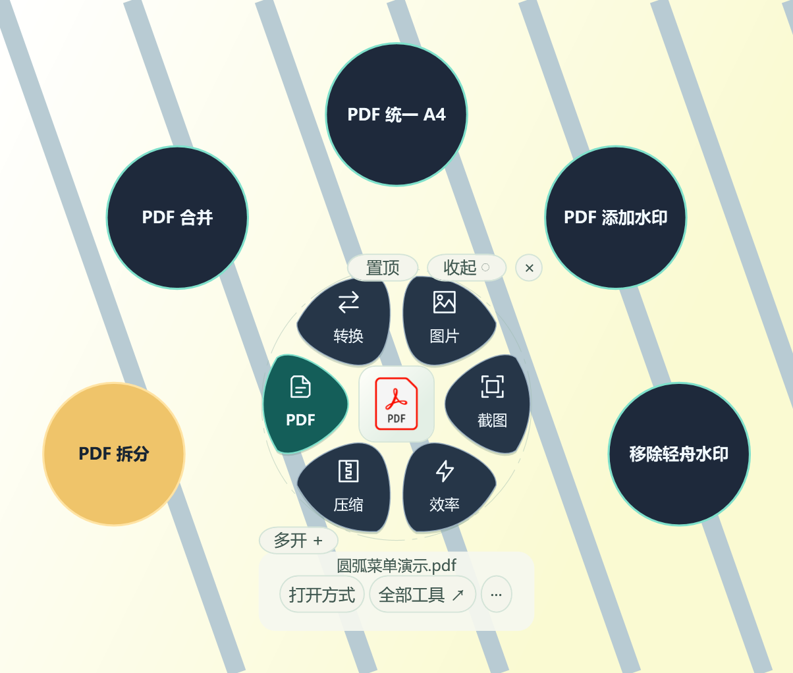

Most desktop utilities ask you to open the application first and then find the file you want to work on. **LightOffice** starts from the other direction: select a file in Windows, open the LightOffice workbench, and choose the operation that fits the file. The result is a small, tray-resident Windows toolbox for the everyday tasks that usually require several unrelated applications.

The current public release is **LightOffice 0.7.3.0**. It is built with C# and WPF for Windows 10 and 11, and targets the system .NET Framework 4.8. The 0.7.3 release improves the Chinese installer and uninstaller with a writable installation directory, license and information pages, progress feedback, an independent uninstaller, and settings-retention options. The runtime workbenches from the 0.7.2 line remain available. The public README keeps the 0.6 gallery as a historical baseline while marking the newer 0.7 interface captures clearly.

The name comes from its six-petal launcher. Each petal represents a group of related operations, while every workbench can be moved, closed, or pinned independently. Selecting another file does not have to interrupt an existing task: open workbenches keep their own context.

## Six groups of practical tools

LightOffice brings small, focused operations together without requiring a browser runtime or a large office suite for the basic package.

| Group | Examples |
| --- | --- |
| Conversion | Convert common image formats and convert DOCX, XLSX, or PPTX to PDF through an optional local Office engine. |
| Images | Resize, crop, rotate, batch-process, pin images to the desktop, and add text watermarks. |
| PDF | Split, merge, normalize pages to proportional A4, add text watermarks, and restore LightOffice watermarks. |
| Screenshots | Capture a region, window, or full screen; annotate, redact, copy, save, pin, run Windows OCR, and translate selected text in the GUI. |
| Archives | Preview ZIP files, create ZIP archives, and optionally use 7-Zip or Bandizip for supported archive workflows. |
| Efficiency | Open files, inspect recommended applications, copy paths, locate files, rename one file or many files, preview text, and process CSV or TSV data. |

The launcher favors common operations and can show up to nine entries in a category. A classic light theme is the default, while the optional circular high-contrast theme synchronizes its colors across workbenches, tables, input fields, output panels, and the screenshot toolbar. If there is not enough room for the circular layout, the launcher falls back to a compact list.

The public catalogue expands those six groups into **24 documented tools**: image conversion and document conversion; resize, crop and rotate, image batching, and image/PDF watermarks; PDF split, merge, A4 normalization, watermarking, and LightOffice-watermark restoration; screenshot capture and desktop pinning; archive creation, extraction, and ZIP preview; and file opening, application selection, locating, path copying, single-file rename, batch rename, text preview, and data science. Each entry records its input, output, limits, and a matching screenshot instead of presenting a button list without context.

## A lightweight data workflow

The CSV and TSV workbench is designed for a useful middle ground between opening a spreadsheet and writing a data-processing script. It can preview a bounded part of a file, then apply operations to the full input:

- choose columns and adjust column names;
- clean whitespace and empty values;
- filter with single or combined conditions;
- remove duplicates and group rows;
- append files with matching headers;
- save a JSON recipe for repeating a workflow; and
- export summary charts or sampled numerical charts as PNG files.

The workbench provides 16 filtering conditions across text, empty-value, numeric, and date fields, with up to eight conditions combined by AND or OR. It also supports typed columns, single- or multi-column deduplication, five aggregation functions (count, sum, average, minimum, and maximum), two-to-100-file row appends with one header, and JSON recipe reuse after the input encoding and column structure are checked. The chart tools distinguish a full-file summary from a bounded numerical sample. The sample size, valid rows, empty values, and fixed seed are shown so that a quick chart is not mistaken for a complete statistical analysis. LightOffice does not claim to be a structured XLSX editor or a fast importer for 500 MB to 2 GB Excel workbooks.

The repository includes a synthetic `sales.csv`, a reusable filtering recipe, and exported CSV and PNG results. A first run can filter the sample for `Region = East China`, preview the matching rows, save a new CSV, and then continue to grouping or charting without touching the source file.

## Screenshots, OCR, and translation in one flow

The screenshot workbench keeps capture and follow-up actions together. The default shortcut is `Ctrl+Alt+S`; after a capture, `Ctrl+Shift+O` starts Windows OCR and `Ctrl+Shift+T` requests translation. Captures can be rectangular, window-based, or full-screen, with rectangles, arrows, text, redaction, undo, keyboard nudging, color palettes, and line-width controls. Results can be copied, saved, saved and pinned, or pinned directly; a pinned image can be moved, zoomed, resized, restored, saved again, or kept on top.

Shortcuts can be configured and checked for conflicts. OCR is performed with Windows language capabilities, while translation is an explicit user action that sends the selected text to the configured translation service. The 0.7 series can configure MyMemory or LibreTranslate, including the service address, key, and connection test. The result stays visible in the LightOffice workbench and can be copied or saved.

This design keeps the network boundary visible: ordinary image, PDF, archive, and data operations run locally. Online translation is not silently enabled by opening a file; it happens only after the user chooses it.

## Optional engines, explicit boundaries

The base package does not bundle LibreOffice, Microsoft Office, 7-Zip, Bandizip, Python, R, DuckDB, or a browser runtime. When a task needs one of those engines, LightOffice can use a compatible component already installed on the machine, subject to that component's own license and behavior. The optional-components panel can detect an existing program, import an offline package, enable or disable it, and show its current status. PDF page previews can use the Windows PDF thumbnail processor or optional MuPDF. The application also keeps boundaries visible: it does not promise general scanned-PDF watermark removal, password or split-volume archive support, RAR creation, offline translation models, or large-workbook editing.

The release documentation includes feature guides, quick-start examples, six task tutorials, screenshots, troubleshooting notes, and SHA-256 instructions. The [setup installer](https://github.com/mengqy2022/LightOffice-Public/releases/download/v0.7.3/LightOffice-0.7.3.0-Setup.exe) and [portable ZIP](https://github.com/mengqy2022/LightOffice-Public/releases/download/v0.7.3/LightOffice-0.7.3.0-windows.zip) are also linked directly from the public README. Download the matching `.sha256` files from the [release page](https://github.com/mengqy2022/LightOffice-Public/releases/tag/v0.7.3), verify them with PowerShell, and keep the complete extracted directory with its DLLs, configuration, and notices rather than copying only the EXE.

The installer is intended for a writable per-user directory and does not require administrator access. The portable package is useful when installation is not wanted; both routes require Windows 10/11 and .NET Framework 4.8. The 0.7 series supports version coexistence, standard uninstall, and rollback guidance. Login startup is opt-in and deliberately runs in the background.

## A three-minute first run

The public repository includes a [quick-start guide](https://github.com/mengqy2022/LightOffice-Public/blob/main/docs/quickstart.md) and six task-based tutorials. One simple path is:

1. Download the synthetic [`sales.csv`](https://github.com/mengqy2022/LightOffice-Public/blob/main/examples/sales.csv) file and select it in Explorer.
2. Open **Data Science** from the Efficiency group or the full tool catalogue. The bounded preview shows six rows and four columns without changing the source file.
3. Filter `Region` to `East China`, preview the result, and use **Process and Save As** to create a new CSV.
4. Open the output and continue with cleaning, deduplication, grouping, recipe saving, or chart export.

The [six tutorials](https://github.com/mengqy2022/LightOffice-Public/blob/main/docs/tutorials.md) continue with proportional A4 PDF conversion, batch image resizing and watermarking, screenshot OCR and translation, Windows application associations, and batch rename recovery. Their before-and-after images use synthetic inputs, and the public README labels step GIFs as image sequences rather than operation recordings.

## Verification and what the measurements mean

The project keeps separate evidence for interface behavior, exported files, and release packaging. The documented checks cover CSV and TSV processing, image and PDF operations, proportional A4 output, watermark restoration, archive extraction with path and size limits, Windows shortcut handling, workbench behavior, OCR, and the public screenshot gallery. The public validation materials report 24 tools, 62 interface images, synthetic examples, and explicit limits around optional engines. Demonstration images use synthetic input files and are not presented as proof that every possible document or Windows configuration is supported.

Some conditions still depend on the user's environment. Login startup, Explorer recovery, sleep and resume, real multi-monitor DPI changes, every Office layout, every PDF font, and every archive encoding require validation on the corresponding machine. The public catalogue also calls out unsupported spreadsheet formulas, pivot tables, cross-table joins, Parquet/DuckDB workflows, generic PDF watermark removal, encrypted or split archives, RAR creation, and built-in offline translation. Package size is not used as a substitute for process-memory measurements, and short resource samples are not a guarantee of a long-running memory ceiling.

## Download and repositories

The product documentation and downloads are maintained in the public [LightOffice-Public repository](https://github.com/mengqy2022/LightOffice-Public). Start with the [latest GitHub Release](https://github.com/mengqy2022/LightOffice-Public/releases/latest), then follow the [three-minute quick start](https://github.com/mengqy2022/LightOffice-Public/blob/main/docs/quickstart.md), [six task tutorials](https://github.com/mengqy2022/LightOffice-Public/blob/main/docs/tutorials.md), [full feature catalogue](https://github.com/mengqy2022/LightOffice-Public/blob/main/docs/catalog.md), [examples](https://github.com/mengqy2022/LightOffice-Public/tree/main/examples), and [installation guide](https://github.com/mengqy2022/LightOffice-Public/blob/main/docs/installation.md).

The complete development checkout, tests, build scripts, and engineering records are kept in the [LightOffice source repository](https://github.com/mengqy2022/LightOffice). The two repositories have different purposes: the public repository is the safe place to obtain releases, documentation, synthetic examples, screenshots, and issue forms; the source repository contains the development history and is not the public product-download repository. The README also links a categorized screenshot wall and issue forms for bug reports and feature requests.

## License note

Please read the license before redistributing the program. LightOffice 0.7.2.0 and later newly licensed proprietary materials are distributed under the project's proprietary software and materials license. Earlier material that was already granted under MIT keeps those grants, and third-party components keep their own licenses. The [public licensing guide](https://github.com/mengqy2022/LightOffice-Public/blob/main/docs/licensing.md) and the notices shipped with a release describe those boundaries in detail.

That distinction matters when linking to the project: the public GitHub repository is an open product-information and release repository, while the current complete source checkout is maintained separately. It should not be described as a fully open-source release unless the applicable license is changed for that material.

If you want a small Windows workbench that follows the selected file instead of forcing every task into one large application, try the [LightOffice downloads](https://github.com/mengqy2022/LightOffice-Public/releases) and share feedback through the project's [issue tracker](https://github.com/mengqy2022/LightOffice-Public/issues).
::github{repo="mengqy2022/LightOffice-Public"}