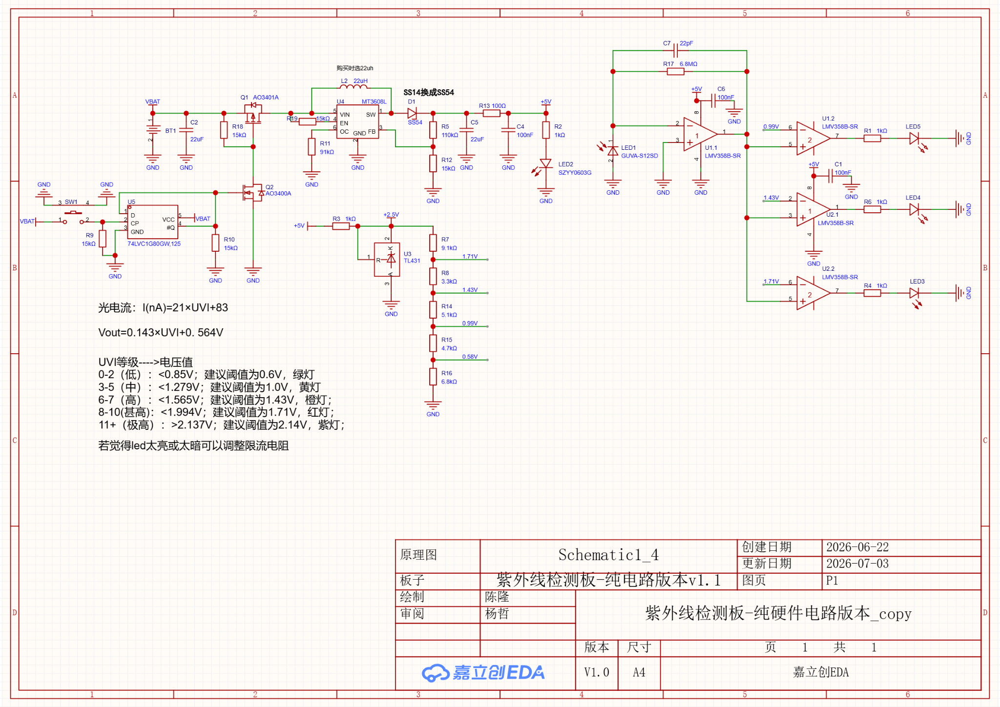
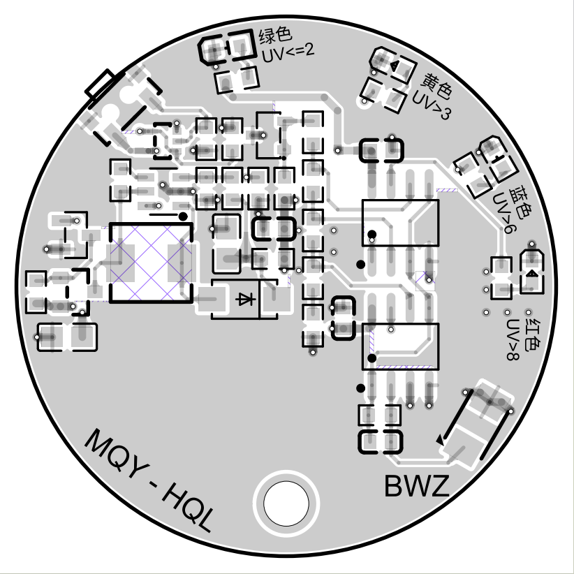
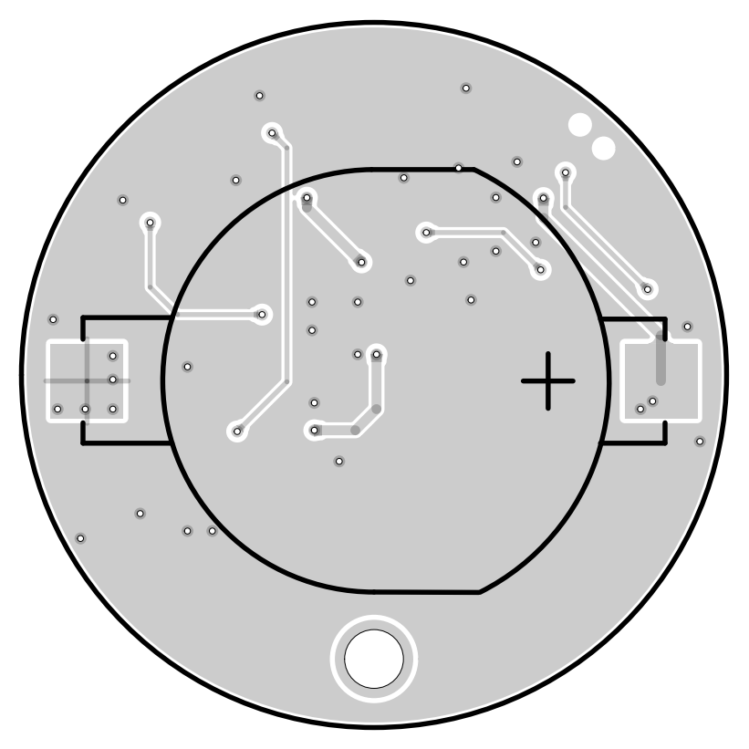
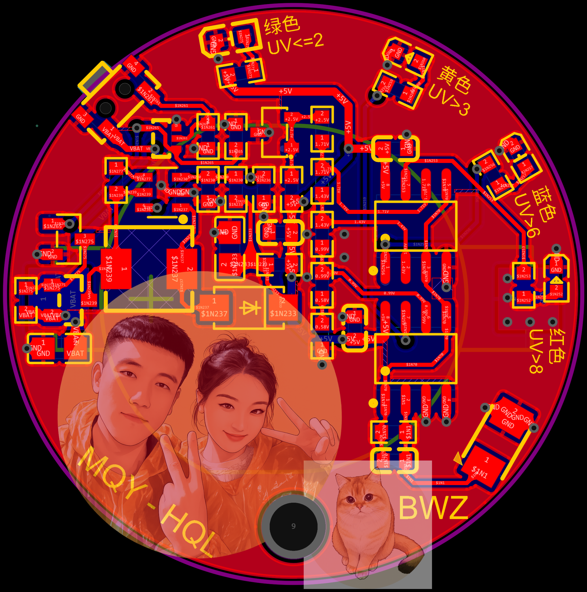

## Project Overview

This project is a compact ultraviolet (UV) intensity detection board designed with a **pure hardware architecture**.

The system does not rely on:

- Microcontrollers;
- Firmware programming;
- Digital communication modules.

The complete detection process is implemented through analog electronic circuits:

```text
UV Radiation
      ↓
UV Sensor
      ↓
Current-to-Voltage Conversion
      ↓
Signal Amplification
      ↓
Voltage Comparison
      ↓
LED Indicator Output
```

The circuit and PCB were designed using **JLCEDA**.

Official website:

The project was designed in [JLCEDA](https://lceda.cn/).

## Hardware Functions

### UV Intensity Detection

The UV sensor converts ultraviolet radiation into an electrical signal.

According to the schematic design, the photodiode output current is related to UV intensity:

```text
I(nA) = 21 × UV + 83
```

The sensor signal is converted into voltage:

```
Vout = 0.143 × UV + 0.564 V
```

This voltage is processed by the analog circuit and used for UV level classification.

### UV Level Indication

The board provides multiple LED indicators.

The threshold design is:

| UV level | Voltage threshold | Indicator |
| --- | ---: | --- |
| 0–2 | < 0.85 V | Green LED |
| 3–5 | < 1.279 V | Yellow LED |
| 6–7 | < 1.565 V | Blue LED |
| 8–10 | < 1.994 V | Red LED |
| 11 and above | > 2.137 V | High-level indication |

The user can directly identify UV intensity through LED color changes.

## Circuit Design

### Power Supply Circuit



The power module contains:

- Battery input;
- Power switch;
- Voltage conversion circuit;
- +5 V analog supply generation.

Main functions:

- Provide stable operating voltage;
- Reduce battery consumption;
- Improve circuit reliability.

### UV Signal Acquisition Circuit

The UV sensing stage consists of:

- UV photodetection element;
- Operational amplifier;
- Feedback network.

The weak sensor current signal is converted into a stable voltage signal.

Signal processing:

```text
UV Sensor Current
        ↓
Operational Amplifier
        ↓
Voltage Signal
        ↓
Comparator Input
```

### Analog Amplification and Comparison

The circuit uses LMV358 operational amplifiers.

Functions:

- Signal amplification;
- Voltage buffering;
- Threshold comparison.

Different comparison thresholds correspond to different UV levels.

## PCB Design

### PCB Top Layout



The PCB adopts a circular structure.

Advantages:

- Compact size;
- Portable design;
- Short signal paths;
- Easy integration into wearable devices.

Functional areas:

| Region | Function |
| --- | --- |
| Left | Power supply and battery circuit |
| Center | Analog processing circuit |
| Outer edge | UV indicator LEDs |
| Bottom | Pin header and expansion |

### PCB Bottom Layer



The bottom layer mainly provides:

- Ground plane;
- Signal routing;
- Mechanical support.

The layout separates sensitive analog signals from power circuits to reduce interference.

## Prototype



The final PCB design integrates:

- Circular PCB structure;
- Multiple UV indicator LEDs;
- Battery interface;
- Debug and expansion pins.

The physical prototype also includes external pin-header connections for testing and modification.

## Design Tool

JLCEDA is an online EDA platform supporting:

- Schematic design;
- PCB layout;
- Component management;
- Manufacturing preparation.

The schematics and PCB were developed with [JLCEDA](https://lceda.cn/), an online EDA platform for schematic capture, PCB layout, component management, and manufacturing preparation.

## Summary

This UV detector board demonstrates a complete analog hardware sensing system.

The design achieves:

**UV sensing → analog processing → threshold decision → visual feedback**

without requiring software control.

It is suitable for:

- Electronics education;
- PCB design practice;
- Sensor system development;
- Low-power portable hardware projects.

